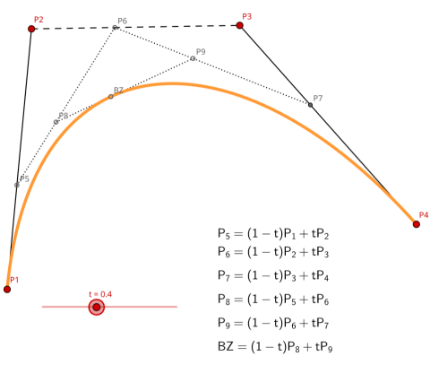
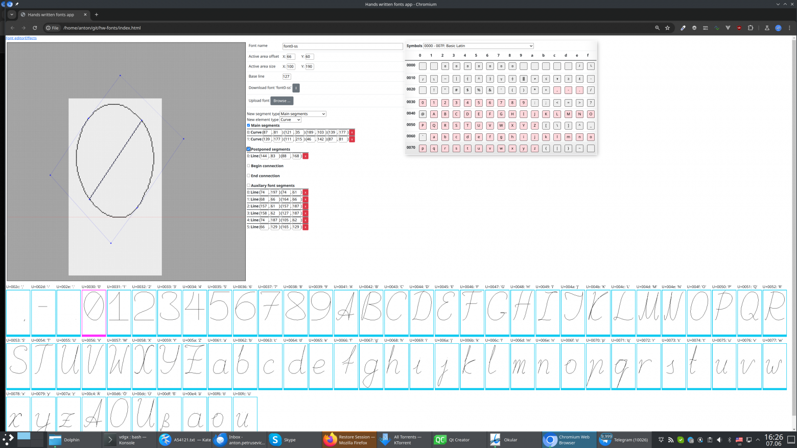

# A Bézier Curve Font on a Microcontroller

*Translated from the Russian original, first published on [Habr](https://habr.com/ru/articles/818873/).*

**Idea**

I picked up the idea in a channel about ESP32 programming, where someone showed a clock made of 6 displays. Each digit had a display of its own, a 1.8" 128x160 one. The author named his source of inspiration: Bézier Clock, a JavaScript project by Jack Frigaard. Unfortunately, the original demo page seems to be gone, but it certainly inspired quite a few people. There is even a Habr article about it, [Bézier Curve Clock](https://habr.com/ru/articles/236455/) (in Russian). Without even asking how exactly it was done, I decided right away to build my own project on Bézier curves and quickly tried out a first version to see how it would look on a display. [The experiment's code](https://github.com/jef-sure/digits_morping_dgx).

<iframe src="https://www.youtube-nocookie.com/embed/C7KjN-NJD5o" title="YouTube" allowfullscreen></iframe>

**Theory**

A cubic Bézier curve describes a smooth curve with two bends between its end points. This class of curves is covered in detail in plenty of literature, and also on [Wikipedia](https://ru.wikipedia.org/wiki/%D0%9A%D1%80%D0%B8%D0%B2%D0%B0%D1%8F_%D0%91%D0%B5%D0%B7%D1%8C%D0%B5) (in Russian).

<figure markdown="span">
  
  <figcaption>An example of a Bézier curve</figcaption>
</figure>

To pin things down, I chose a virtual 100x160 field for the control points, a size I considered "big enough". The first digit I practiced on was `2`. It has three parts: the upper semicircle, a winding "neck" and the base. I wanted this digit to look exactly like that, so I needed three curves. Two curves would have been enough for most digits, so the third one had to be fitted in somewhere anyway. Some curves have control points outside the 100x160 field, but the curves themselves stay inside it.

**Morphing**

To animate a curve, its control points move in straight lines from their old positions to the new ones, and a new curve is built from the moved points. The parameter `t` runs from 0 to 1, so a new point is Pn(t) = Pa + t\*(Pb - Pa). The value of t is tied to the clock so that it covers [0,1] in half a second. When a character has to leave the screen, or has to appear where there was none, all the points of that curve sit at the same coordinates in the center of the virtual field. Once all the points of a curve are equal, the curve is no longer drawn.

The start of the animation is timed so that it ends exactly when the second shown on the screen arrives. Unlike the author of the clock that inspired me, I felt that a "quiet" period was necessary, so that the brain has time to focus on the information shown. By experiment I settled on half a second of quiet as comfortable.

**First experiment**

Once I was sure the animation was satisfactory, I set about "drawing" the digits. I pictured the coordinates of the control points on the 100x160 virtual field in my head, then adjusted them until the result looked like a handwritten character. Only after this stage did the actual programming of the project begin. This is what came out:

<iframe src="https://www.youtube-nocookie.com/embed/dXjHZpKN25c" title="YouTube" allowfullscreen></iframe>

**Choosing the hardware**

While experimenting, I tried a layout of one "big" display and two smaller ones side by side.

<iframe src="https://www.youtube-nocookie.com/embed/wR6TzI_tLKw" title="YouTube" allowfullscreen></iframe>

In the end I chose a single display, the largest one I could get at the time: 2.8", 320x240, with an ILI9341 controller.

<iframe src="https://www.youtube-nocookie.com/embed/GvBGo-hvBrQ" title="YouTube" allowfullscreen></iframe>

I chose the ESP32 microcontroller for its powerful hardware and its WiFi, which lets the clock sync over NTP. I used some standard development board; the link to it no longer works. The main requirement is enough RAM for the virtual screens.

**The font**

I "made up" the whole font myself. The only tools were a text editor, where I adjusted the point coordinates, and my head, where I first tried to picture where the points should go on the field. The resulting characters look like handwriting, and my wife tells me it is very much like my own. Flattering.

To draw digits at a given size, the code applies an affine transformation, "scale and translate". The point coordinates are scaled from the 100x160 field to the desired size and shifted by the required vector before the curves are drawn.

The curves are drawn as straight line segments. Each curve is split into N segments. I tried to come up with an algorithm that would pick the number of segments automatically, but in the end settled for a fixed number. I chose it by experiment: low enough not to cause performance problems, high enough for everything to still look smooth. While the curves were thin, they were computed fairly quickly, but for thick ones I had to lower the number to 12. The result is quite satisfactory.

**Graphics**

I wrote the graphics library myself. My interest in graphics as a student came in handy, although there is nothing especially complicated in it. Thick curves are drawn with thick lines, which are really rotated rectangles. The thick-line algorithm is optimized for the way data is sent to the screen. When lines get noticeably thick, gaps can appear on the outer side of the bends of a curve. To avoid this, thick curves get filled circles drawn between their segments, and the circles smooth the gaps over. Unfortunately, I was never entirely happy with how efficiently the algorithm joins the segments of wide lines when a curve is drawn segment by segment, but I haven't had another go at it yet. The library supports different fonts, and the project code includes a program that can generate source code for bitmap fonts from TTF.

On top of that, everything drawn is smoothed by an anti-aliasing algorithm, which creates a smooth transition for the black pixels at the edges of the shapes. To keep the anti-aliasing simple, all the virtual screens are 8-bit, and each byte holds a color intensity. When an 8-bit virtual screen is copied to the physical one, a lookup table translates the colors into 16-bit form. The time and the weather use separate tables; the weather table is recomputed every time the temperature changes.

To save RAM and still have acceptable animation, each character is drawn on its own virtual screen. Then, if the picture on the screen has to change, that virtual screen is output to the physical one at the given coordinates. For this, the virtual screens are passed to the main task, which shows them on the physical screen. This way different tasks never compete for the SPI bus. Once everything needed is drawn on the virtual screens, the drawing task works out how much of its 1/30 of a second is left and sleeps for the rest, handing control to the task that outputs to the physical screen.

**Additional services**

The weather symbols come from the [Weather Icons](https://erikflowers.github.io/weather-icons/) font. They don't quite match the weather conditions the weather service returns, so I had to get creative with the mapping.

The project is built on the standard ESP-IDF framework, version 4.2. With a newer version the code will most likely need adapting.

The WiFi password, the [ipinfo.io](https://ipinfo.io/) API key and the API key for the weather site [openweathermap.org](https://openweathermap.org/api) are set in `sdkconfig` when the project is configured. Not very convenient, but at home, where nothing changes, it doesn't matter much. Later I thought a lot about how to do it better and arrived at the approach I used in [An Animated Dot-Matrix Font on a Microcontroller](../matrix-font-en/index.md).

The color of the weather symbol and of the temperature is also computed by a formula found by experiment. I took 23 degrees as the middle, "comfortable" level: anything below shifts toward blue, anything above toward red.

**How it works**

1. When the microcontroller starts, it begins connecting to the access point;
2. Once it gets an IP address from the access point, it starts a task that periodically fetches the location and a task that syncs the time with a public NTP server;
3. The location comes from the [ipinfo.io](https://ipinfo.io) service;
4. Once the location is known, a task starts fetching the weather from the [openweathermap.org](https://openweathermap.org/) server;
5. The location also gives the time zone;
6. The location and the weather are polled every 10 minutes.

**Result**

<iframe src="https://www.youtube-nocookie.com/embed/7H-2-X1M7PA" title="YouTube" allowfullscreen></iframe>

[Project code on GitHub](https://github.com/jef-sure/ili9341_dgx), MIT license.

**Afterword**

All this happened about three years ago. It was my previous project on a clock of my own on a microcontroller. While building it, I was left with ideas on how to take it further, configuration above all. Information about the city the weather comes from is needed mostly to check that the weather is shown for the right place; it doesn't have to take up space on the screen all the time. In the [next project](../matrix-font-en/index.md) I solved WiFi configuration with Espressif's *ESP SoftAP Provisioning* app, available both on Google Play Market and in the App Store, and the other settings are made in a web interface.

Taking Bézier curve fonts further led me to write a project for editing such fonts. I wrote an [editor](https://github.com/jef-sure/hw-fonts) in JavaScript/Vue.js in which you can draw fonts. The plan was to make a microcontroller library for these fonts, but no new project for them has come up yet, so the topic is on hold for now. It is very easy to use: download or clone the project and open index.html in a browser. As a ready-made font there is a Latin font I drew, `font-ss.json`; it loads into the editor with "upload". The result is saved with "download". Unfortunately, I ran out of steam before the Russian letters: the work is very laborious.

