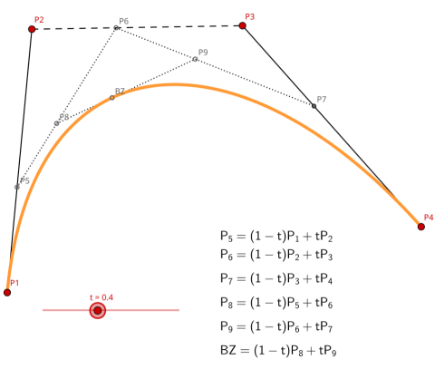
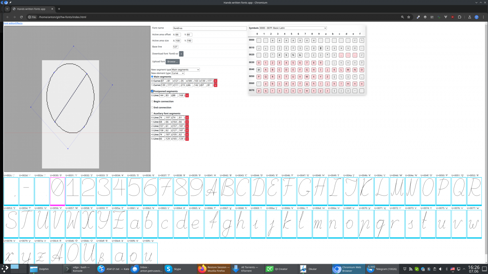

# Шрифт на кривых Безье на микроконтроллере

*Впервые опубликовано на [Хабре](https://habr.com/ru/articles/818873/).*

**Идея**

Идею подсмотрел в канале о программировании ESP32, один человек продемонстрировал часы на 6 дисплеях. Каждая цифра на своём дисплее типа 1.8" 128х160. Разработчик проекта показал источник своего вдохновения: проект Bézier Clock на Javascript разработчика Jack Frigaard. К сожалению, видимо, оригинальная страница демонстрационного проекта не сохранилась, но она точно вдохновила разных людей. Есть даже статья на хабре про это [Часы на кривых Безье](https://habr.com/ru/articles/236455/). Даже не спрашивая как именно это реализовано, я сразу решил делать свой проект на кривых Безье и быстро опробовал первую версию как это будет выглядеть на дисплее. [Код эксперимента](https://github.com/jef-sure/digits_morping_dgx).

<iframe src="https://www.youtube-nocookie.com/embed/C7KjN-NJD5o" title="YouTube" allowfullscreen></iframe>

**Теория**

Кубические кривые Безье позволяют описать плавную кривую с двумя изгибами между крайними точками. Этот класс кривых описан подробно в многочисленной литературе, а так же, в [Википедии](https://ru.wikipedia.org/wiki/%D0%9A%D1%80%D0%B8%D0%B2%D0%B0%D1%8F_%D0%91%D0%B5%D0%B7%D1%8C%D0%B5).

<figure markdown="span">
  
  <figcaption>Пример кривой Безье</figcaption>
</figure>

Для определённости, я выбрал виртуальное поле 100х160, размеры которого посчитал "достаточными", на котором расположены опорные точки. Первая цифра, на которой я тренировался, была `2`. Она состоит из трёх элементов: верхний полукруг, извилистая "шейка" и основание. Эту цифру я хотел сделать именно такой, поэтому, мне потребовалось три кривых. На большинство цифр хватило бы и двух кривых, так что пришлось третью пристраивать куда-нибудь в любом случае. Координаты некоторых кривых выходят за рамки поля 100х160, но сами кривые при этом остаются внутри.

**Морфинг**

Для анимации координаты опорных точек кривой по прямолинейной траектории переходят со старого места на новое. По перемещённым опорным точкам строится новая кривая. Параметр `t` изменяется от 0 до 1, так что новые точки расчитываются как Pn(t) = Pa + t\*(Pb - Pa). Расчёт значения t синхронизирован по времени, чтобы проходить отрезок [0,1] за полсекунды. Если символ надо убрать с экрана, или его не было на экране, а он должен появиться, то все точки этой кривой находятся по одним и тем же координатам в центре виртуального поля. Как только у кривой все точки равны, она больше не рисутеся.

Начало анимации расчитывается так, чтобы анимация завершилась ровно по наступлению секунды, показываемой на экране. В отличии от тех часов, что меня вдохновили, мне показалось, что "спокойный" период необходим, чтобы мозг успел сосредоточиться на показываемой информации. Экспериментально остановился на комфортном времени в половину секунды.

**Первый эксперимент**

Убедившись, что анимация получается удовлетворительная, я принялся за "рисование" цифр. На виртуальном поле 100х160 я в голове представлял координаты опорных точек кривых, затем подгонял, чтобы выглядело похоже на рукописный символ. После этого этапа началось уже программирование проекта. Получилось так так:

<iframe src="https://www.youtube-nocookie.com/embed/dXjHZpKN25c" title="YouTube" allowfullscreen></iframe>

**Выбор железа**

В процессе экспериментов испробовал вариант одного "большого" и двух поменьше рядом стоящих дисплеев.

<iframe src="https://www.youtube-nocookie.com/embed/wR6TzI_tLKw" title="YouTube" allowfullscreen></iframe>

В итоге, выбрал один самый большой (2.8" 320x240 на контроллере ILI9341), какой был доступен мне тогда.

<iframe src="https://www.youtube-nocookie.com/embed/GvBGo-hvBrQ" title="YouTube" allowfullscreen></iframe>

Микроконтроллер ESP32 был выбран за мощную начинку и наличие WiFi, что позволяет синхронизировать часы по NTP. Использовал какую-то стандартную плату разработчика, сейчас линк уже не работает. Основное требование - достаточное количество RAM для виртуальных экранов.

**Шрифт**

Весь шрифт полностью "придуман" мной, не использовалось никакого иного средства, кроме текстового редактора, в котором я подгонял координаты точек, и головы, в которой я предварительно пытался представлять как они должны быть расположены на поле. Получившиеся символы напоминают рукописный шрифт, который, как мне говорит моя жена, очень похож на мой собственный. Льстит.

Для рисования цифр заданного размера используется операция афинного преобразования "масштабирование и сдвиг". Координаты точек из поля 100х160 масштабируется в желаемые размеры и сдвигаются на нужный вектор для рисования кривых.

Кривые рисуются отрезками прямых по сегментам. Каждая кривая разбита на N сегментов. Пытался придумать алгоритм автоматического определения количества сегментов, то, в итоге, решил обойтись фиксированным числом. Число подбиралось экспериментально, чтобы, с одной стороны, не создавалось проблем с быстродействием, а с другой, всё выглядело ещё достаточно плавным. Пока кривые были тонкие, они вычислялись довольно быстро, но с толстыми пришлось число понизить до 12. Результат вполне удовлетворительный.

**Графика**

Графическая библиотека написана мной, сказалось увлечение графикой в студенческие годы, хотя там ничего особо сложного и нет. Для рисования толстых кривых используются толстые линии, которые, фактически, повёрнутые прямоугольники. Алгоритм рисования толстых линий оптимизирован под особенности передачи данных на экран. Если линии становятся заметно толстыми, то на изгибах кривых могут появляться разрывы на внешней стороне изгиба. Чтобы это избежать, между сегментами для толстых кривых рисуются сплошные круги, которые заглаживают эти разрывы. К сожалению, я не остался до конца доволен оптимальностью алгоритма стыковки отрезков широких прямых при рисовании кривых по сегментам, но повторно к снаряду пока не подходил. В библотеке поддерживаются разные шрифты, в коде проекта лежит программа, которая может генерировать исходные коды матричных шрифтов из TTF.

Так же, все нарисованные элементы ещё дополнительно сглаживаются алгоритмом антиалиасинга, который для чёрных точек на границах элементов создаёт гладкий переход. Для простоты реализации алгоритма антиалиасинга, все используемые виртуальные экраны
 8-битные, где каждый байт означает интенсивность цвета. При переносе 8-битного виртуального экрана на физический, используется таблица трансляции цвета в 16-битное представление. Для погоды и времени используются отдельные таблицы, для погоды она расчитывается каждый раз при изменении температуры.

Для экономии RAM но с приемлимой анимацией каждый символ рисуется в своём собственном виртуальном экране, а затем, если изображение на экране должно быть изменено, этот виртуальный экран выводится по заданным координатам на физический. Для этого виртуальные экраны передаются в основной процесс для отображения на физическом экране. Таким образом, разные процессы не будут конфликтовать за шину SPI. После рисования всех необходимых элементов в виртуальных экранах происходит расчёт сколько осталось свободного времени от отведённой 1/30 секунды и задача отрисовки засыпает на этот остаток времени, передавая упраление задаче вывода на физический экран.

**Дополнительные сервисы**

Символы погоды берутся из шрифта [Weather Icons](https://erikflowers.github.io/weather-icons/). Они немного не совпадают с той формой погоды, что возвращает сервис погоды, пришлось творчески придумать отображение.

При реализации использовался стандартный фреймворк ESP-IDF версии 4.2. Если версия новее, то код, наверняка, придётся адаптировать.

Пароль от WiFi, ключ API [ipinfo.io](https://ipinfo.io/) и ключ API от сайта погоды [openweathermap.org](https://openweathermap.org/api) задаются в `sdkconfig` при конфигурировании проекта. Не очень удобно, но для дома, где всё стабильно, не критично. В последствии я много думал как сделать лучше и пришёл к варианту как сделал в [Матричный шрифт с анимацией на микроконтроллере](../matrix-font-ru/index.md).

Цвет символа погоды и температуры расчитывается так же по экспериментально подобранной формуле. 23 градуса я принял за средний "комфортный" уровень, что ниже идёт в синий цвет, а что выше в красный.

**Функционирование**

1. После запуска микроконтроллера запускается процесс соединения с точной доступа;
2. После успешного получения IP от точки доступа, запускается процесс периодического получения местоположения и процесс синхронизации времени с публичным NTP сервером;
3. Для получения местоположения используется сервис [ipinfo.io](https://ipinfo.io);
4. После получения местоположения, запускается процесс получения погоды с сервера [openweathermap.org](https://openweathermap.org/);
5. Получение местоположения позволяет определить временную зону для времени;
6. Опрос местоположения и погоды происходит каждые 10 минут.

**Итог**

<iframe src="https://www.youtube-nocookie.com/embed/7H-2-X1M7PA" title="YouTube" allowfullscreen></iframe>

[Код проекта на github](https://github.com/jef-sure/ili9341_dgx), лицензия MIT.

**Послесловие**

Описываемые события произошли прмерно три года назад. Это мой предыдущий проект на тему собственных часов на микроконтроллере. В процессе реализации у меня остались мысли о последующем развитии. Особенно вопрос конфигурирования. Информация о городе, для которого берётся погода нужна больше для контроля, что погода показывается для правильной местности, не обязательно занимать место на экране постоянно. В [следующем проекте](../matrix-font-ru/index.md) я решил вопрос конфигурирования WiFi с помощью приложения *ESP SoftAP Provisioning* от Espressif, которая есть как в Google Play Market, так и в App Store, а остальные настройки делаются в веб-интерфейсе.

Развитие темы шрифтов на кривых Безье привело меня к написанию проекта по редактированию таких шрифтов. На Javascript/Vue.js я написал [редактор](https://github.com/jef-sure/hw-fonts), в котором можно рисовать шрифты. Задумка была сделать библиотеку для микроконтроллера для таких шрифтов, но нового проекта для них у меня пока не возникло и тема пока подвисла. Пользоваться очень просто: достаточно загрузить код проекта или склонировать его и открыть в браузере index.html. В качестве уже готового шрифта есть мной нарисованный латинский шрифт `font-ss.json`, который грузится в редактор нажатием на "upload". Результат сохраняется нажатием на "download". К сожалению, на русские символы меня уже не хватило, работа очень трудоёмкая.

