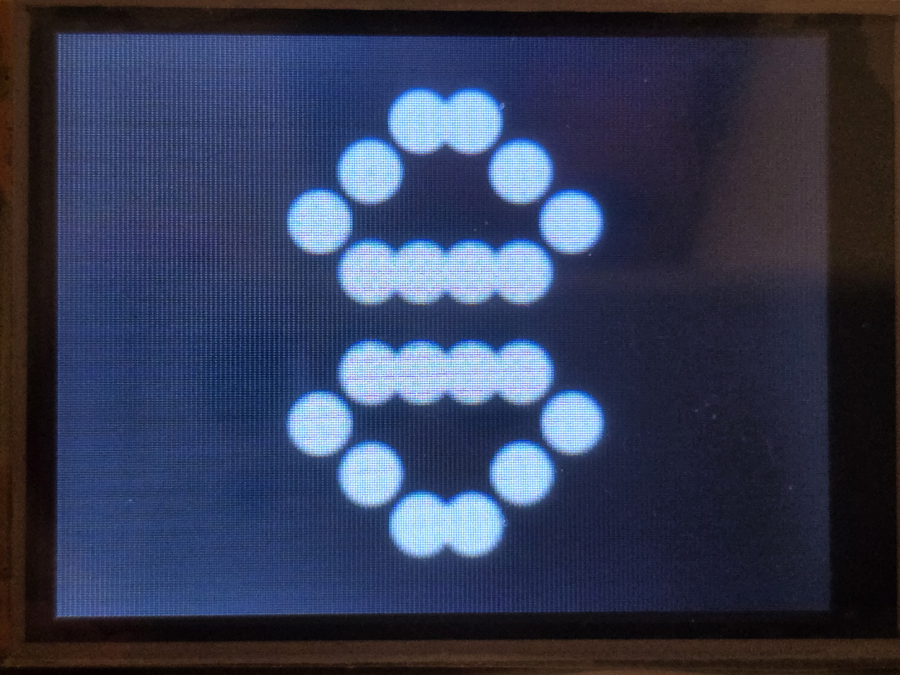
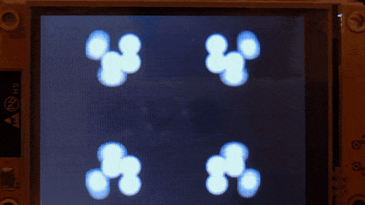
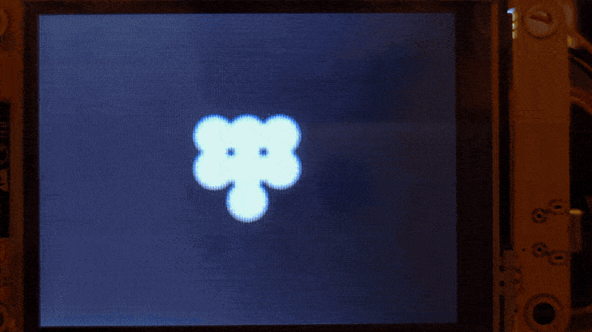
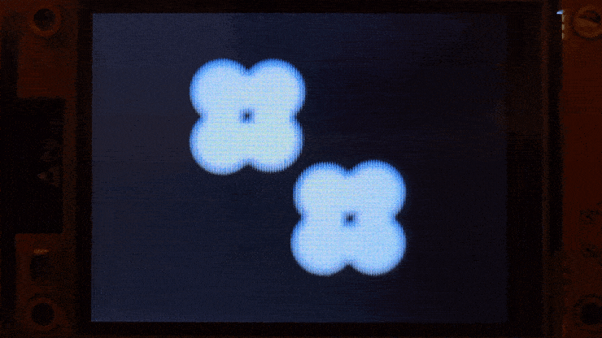
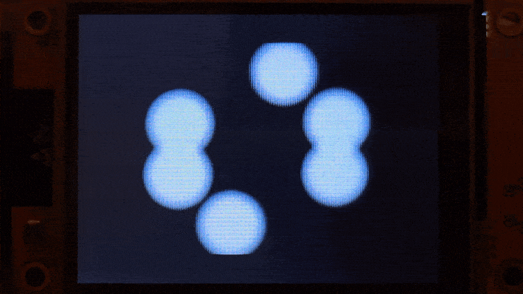
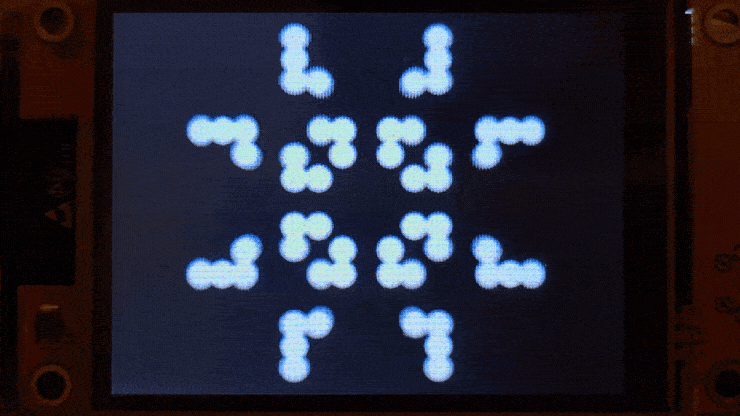

# Morphing Cell Patterns in the Game of Life on a Microcontroller

*Translated from the Russian original, first published on [Habr](https://habr.com/ru/articles/1081830/).*



This isn't my first experiment with animating the transition between graphic shapes. The first one was with Bézier curves, [A Bézier Curve Font on a Microcontroller](../bezier-font-en/index.md), and the next with a dot-matrix font, [An Animated Dot-Matrix Font on a Microcontroller](../matrix-font-en/index.md). This time, watching someone else's project gave me the idea of animating the Game of Life. Why the Game of Life? Its dots are born and die right next to each other, so the transitions between them can be built automatically.

The rules of the Game of Life in brief: a field of cells, each of them "dead" or "alive." Every cell has 8 neighbors. A live cell with 2 or 3 live neighbors stays alive. A dead cell with exactly 3 live neighbors comes to life. In every other case the cell stays dead or dies.

## The idea

There are two steps: the current one and the next. The algorithms that compute a step are simple and well worn, so I won't dwell on them. The code walks the whole matrix and looks at `cell_case = current->cells[idx] + next->cells[idx] * 2`. That gives 4 possible values, from 0 to 3. 0 means the cell was dead and stays dead; 3 means a live cell that survives. 1 means the cell dies, and 2 means it comes to life. Case 2 is the most interesting one. A cell that has come to life has exactly 3 live neighbors, and this is where you can find out which neighbors took part in the birth of the new cell. The code goes around the neighbors and records every one that is alive in the current step as a "parent": it marks them in the "served as a source" map and notes that the birth has to be morphed.

**Static dots**

In case 3, where a dot survives, it is simply drawn in place.

**Fading dots**

Case 1 is handled separately: a dot that did not survive may still have served as a source for the birth of another dot, and that has to be checked. If it did not, it goes on the fading list and fades out gradually.

Fading is simpler than birth: no "head" and no "tail," just a linear drop in brightness from 255 to 0 as `t` advances:

```cpp
uint8_t t_fade = max_int(0, 255 - (int16_t)(255.0f * t));
```

This value is passed to `collect_glow()`, the same function that accumulates brightness for the dots being born and the static ones, only as an intensity that decreases instead of staying constant.

**Birth**

A live cell is drawn with discs whose brightness falls off from the center. The brightness formula is `255 * (1 - 3x^2 + 2x^3)`, where `x` is `d/R`. The math is fairly heavy for a microcontroller, but in reality all the calculations are optimized for integer arithmetic and precomputed brightness values. Even the distance is replaced by its square, so there is no square root to take.

The birth animation launches two discs, one after the other, and the brightness around each of them adds up. That gives a "head" and a "tail" with a bright bridge between them. The distance between the head and the tail changes as they move: on the segment from one cell to the other the head is always at position `t`, while the tail first lags behind and then catches up. `t` is a number from 0 to 1 that tells how far along its path the transformation is; it grows linearly with the elapsed time. The tail waits until the head is halfway there, then quickly catches up: `t_tail = max(t * 1.5f - 0.5, 0)`.

A dot always has three parents, and each of them launches two discs, so one dot gets 3 × 2 = 6 light sources. Each of them is drawn with a maximum brightness of 255/6, so that in the final dot they add up to the right total brightness. That causes a problem: dots that were bright a moment ago become 3 times dimmer (in fact 3 to 6 times, but since the head runs away, the drop doesn't hurt the animation; if anything, it looks natural). To avoid such a sharp jump, the "brightness map" is double-buffered: once the brightness contributed by all the dots has been computed and drawn on the screen, the result is not thrown away but used for blending in the next step.

The blending formula:

```cpp
intensity = glow_next[glow_idx] * t_smooth + (1 - t_smooth) * glow_prev[glow_idx]
```

The resulting `intensity` is stored in `glow_next[glow_idx]`, where `t_smooth = t * t * (3 - 2 * t)` is the [smoothstep](https://en.wikipedia.org/wiki/Smoothstep) formula.

The algorithm is relatively simple, yet it took quite a lot of experiments, and a couple of times I "got lost in the weeds" or ended up with a result I didn't like the look of.

## Optimizing for the microcontroller

**The type of stored coordinates**

At first I simply used `int x, y`. I have quite a few preallocated arrays for dots and segments, to avoid memory fragmentation. Naturally, everything in them is allocated with room to spare. And for some configurations an array turned out to take several tens of kilobytes. Switching to `int16_t` cuts the memory in half.

**From floating point to fixed point in hot spots**

Before:

```cpp
  float    t_smooth = smoothstep3(t);
  uint8_t intensity = glow_accu[glow_idx]*t_smooth +
    (1 - t_smooth) * transformation->glow_prev[glow_idx];
```

After:

```cpp
  float    t_smooth = smoothstep3(t);
  uint32_t t_fx     = (uint32_t)(256.0f * t_smooth);
  uint8_t intensity = (glow_accu[glow_idx] * t_fx +
    (256 - t_fx) * transformation->glow_prev[glow_idx]) >> 8;
```

`t_smooth` and `t_fx` are computed once, before the loop; inside it, where most of the operations are, integer arithmetic with sufficient precision replaces floating point.

**Heavy calculations done in advance**

The brightness as a function of the distance between the scanned pixel and the center of the disc is precomputed once, when the disc radius is calculated. The radius is unlikely to be very large: say 50, even if the grid is only 3 cells high. That is at most 2500 different distance values, which the ESP32 can certainly handle.

```cpp
    transformation->rlut_limit  = transformation->radius * transformation->radius;
    for (int i = 0; i < transformation->rlut_limit; i++) {
        float x                 = (float)i / transformation->rlut_limit;
        transformation->rlut[i] = 255.0f * (1.0f - smoothstep3(x));
    }
```

and then:

```cpp
  int dy2      = dy * dy;
  //...
  int distance = dx * dx + dy2;
  int falloff  = transformation->rlut[distance];
```

Anything in a cell that falls outside the disc adds no brightness, so there is little point in scanning those pixels. Leaving out the corners of the cell skips about 28% of them. For that, an array of X offsets within the cell is precomputed, indexed by the Y coordinate within the cell (`dy`):

```cpp
  for (int dy = 0; dy <= transformation->radius; dy++) {
      int rem = transformation->rlut_limit - 1 - dy * dy;
      transformation->xcell_offset[dy] = (rem >= 0) ? (int)sqrtf((float)rem) : -1;
  }
```

The loop that scans the cell then uses it like this:

```cpp
  int max_dx = transformation->xcell_offset[abs(dy)];
  if (max_dx < 0) {
      continue;
  }
  int x0 = max_int(point.x - max_dx, 0);
  int x1 = min_int(point.x + max_dx, transformation->grid_width - 1);
  if (x0 > x1) {
      continue;
  }
  for (int x = x0; x <= x1; x++)
  // ...
```

**Shifts instead of division**

```cpp
  int contribution = div255(falloff * intensity);
```

Both values here, `falloff` and `intensity`, lie in the range 0..255, so instead of dividing you can use a "hack" that works for a limited range: `n/255 ≈ n/256 + n/65536`:

```cpp
static inline uint32_t div255(uint32_t n)
{
    return (n + 1 + (n >> 8)) >> 8;
}
```

Shifts and additions are much faster here than division. I checked what `gcc` does: it replaces the division with a multiplication, which is better, but still not as fast.

## Starting patterns for the Game of Life

**1. Gliders collision**

Four small spaceships start in the corners of the field and fly toward each other. At step 13 the program sees that nothing moves any more, and the animation starts over. The return to the start looks almost like a loop.



**2. Navy T‑tetromino**

A compact shape of four cells in the form of the letter T. It is a typical short example of rapid growth: the pattern expands quickly, then goes through several transitional phases and settles down.



**3. Beacon**

A pattern of two adjacent 2×2 blocks that form an oscillator with period 2. It looks like a "beacon," or like two overlapping spirals that flash and then "switch" between two states.



**4. Toad**

The pattern consists of two rows of three cells, offset from each other. It is also an oscillator with period 2 and turns from a horizontally stretched shape into a vertical one and back.



**5. Pulsar**

A large symmetric oscillator with period 3. It consists of several long rays and is highly symmetric, which makes for very beautiful, regular motion.



**6. R‑pentomino**

The R‑pentomino is the classic "methuselah": only 5 cells, but before it settles down it puts on a long, chaotic "fireworks show."

<div class="video"><iframe src="https://www.youtube-nocookie.com/embed/z4pk1Ff3zsY" title="YouTube" allowfullscreen></iframe></div>

## Platform

The ESP32-Cheap‑Yellow‑Display is an inexpensive board with a built-in microcontroller, a display, and RESET and BOOT buttons; I didn't use anything else on it. On the whole, the board doesn't matter much: any suitable display will do, but the code in the repository is written for the CYD. Moving to another display supported by the [DGX](https://github.com/jef-sure/esp32-component-dgx) library takes nothing more than changing the driver in the code.

A single press of the BOOT button switches between the starting patterns. A simple state machine handles this, so that holding the button down doesn't flip through the patterns one after another. If the configuration degenerates or turns into a still life, the simulation restarts from the original pattern on its own. At startup the application picks the cell size to fit the available memory, shrinking it until the virtual screen and the buffers fit in RAM, and once a second it writes the current FPS to the serial log.

The full code of the project is in the [cyd‑life‑morphing](https://github.com/jef-sure/cyd-life-morphing) repository under the MIT license.

## Results

I got what I wanted: instead of the usual discrete change of generations of a cellular automaton, a smooth, almost living flow of light. Most of the fiddling was not with the Game of Life itself (that part is trivial) but with keeping the transition between frames from looking jerky while still fitting within what the ESP32 can do. It runs at 25–26 FPS, rendering almost the whole 320×240 screen.

In fact, I used the Game of Life in this project simply because it seemed to me the easiest way to get the anchor points. The same rendering principle works for other, similar transitions between frames.

The code is open; adding your own pattern takes a few lines, and the README has an example. If you try it on your own board, find a bug, or know how to squeeze out more performance, let me know.
