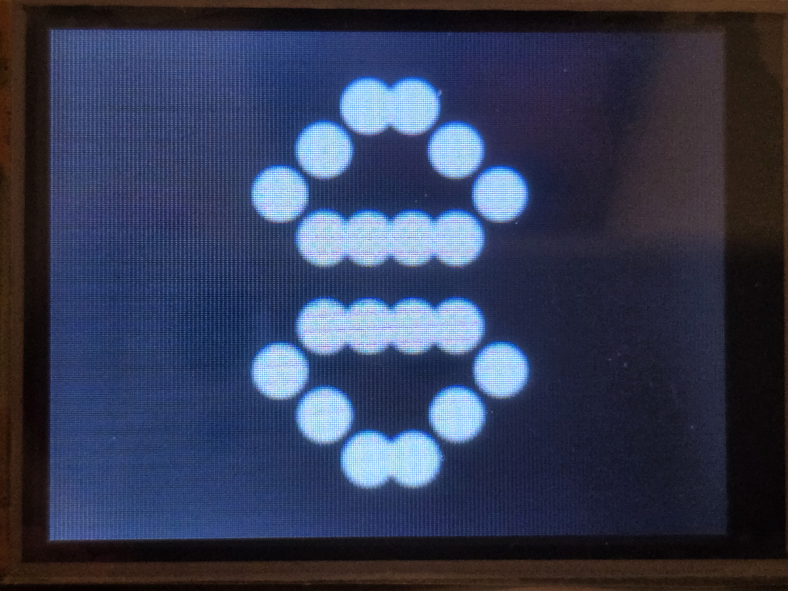
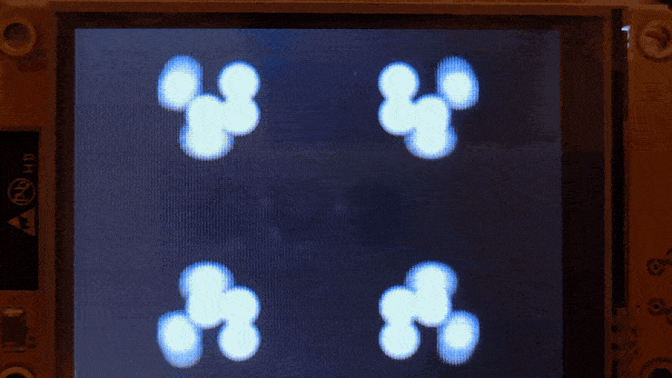
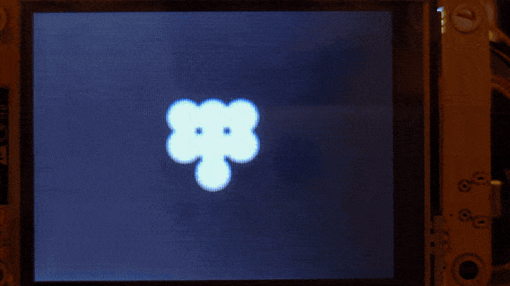
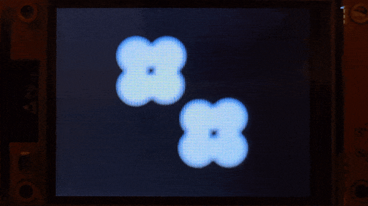
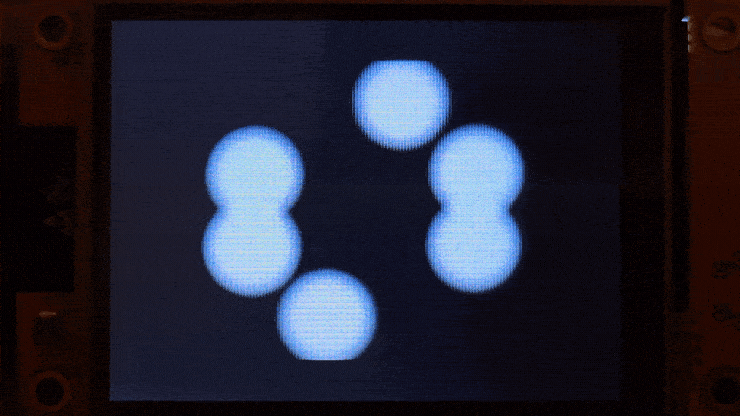
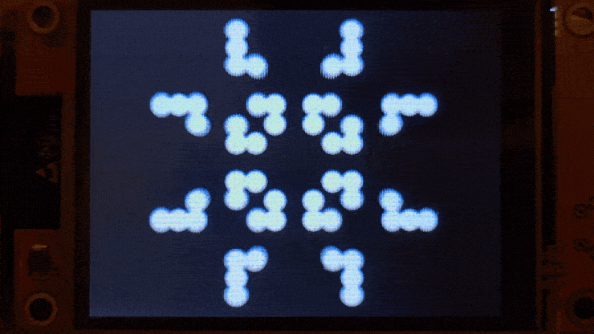

# Морфинг клеточных структур в игре «Жизнь» на микроконтроллере

*Впервые опубликовано на [Хабре](https://habr.com/ru/articles/1081830/).*



Это уже не первый мой эксперимент с оживлением перехода графических форм. Мой первый эксперимент был с кривыми Безье: [Шрифт на кривых Безье на микроконтроллере](../bezier-font-ru/index.md), затем с матричным шрифтом [Матричный шрифт с анимацией на микроконтроллере](../matrix-font-ru/index.md). В этот раз наблюдение за чужим проектом навело меня на мысль об анимации Game of Life. Почему именно Game of Life — точки рождаются и умирают в непосредственной близости друг от друга, что позволяет построить автоматические переходы между ними.

Кратко правила Game of Life: на поле из клеток есть «мёртвые» и «живые». Вокруг каждой клетки есть 8 соседей. Если вокруг живой клетки 2 или 3 живых соседа, то она продолжает жить. Если вокруг мёртвой клетки есть ровно 3 живых, то она так же оживает. Во всех остальных случаях клетка остаётся или становится мёртвой.

## Идея

Есть два шага: текущий и следующий. В силу простоты и избитости алгоритмов формирования шагов, я не буду останавливаться на них. Проходим по всей матрице и смотрим `cell_case = current->cells[idx] + next->cells[idx] * 2`. Получается 4 возможных значения от 0 до 3. 0 означает, что клетка была мёртвой и такой и останется, 3 означает, что это выжившая живая клетка. 1 означает, что клетка умирает, а 2 — что эта клетка оживает. Случай 2 самый интересный. Если клетка ожила, то вокруг неё есть ровно 3 соседа, и вот тут можно понять, кто эти соседи, которые поучаствовали в рождении новой клетки. Нужно обойти соседей вокруг и всех, кто на текущем шаге живой, записать в «родителей» — отметить их в карте «послужили источником» и зафиксировать необходимость морфинга процесса рождения.

**Статичные точки**

Для случая 3, когда точка выживает, точки просто рисуются статично.

**Гаснущие точки**

Случай 1 обрабатывается отдельно, поскольку надо проверить, не послужила ли точка источником для рождения другой точки, хоть сама и не выжила. Если не послужила, то она записывается в гаснущие и будет постепенно гаснуть.

В отличие от рождения, затухание устроено проще — без «головы» и «хвоста», просто линейное падение яркости от 255 до 0 по мере продвижения `t`:

```cpp
uint8_t t_fade = max_int(0, 255 - (int16_t)(255.0f * t));
```

Это значение передаётся в ту же функцию сбора яркости `collect_glow()`, что и для рождающихся и статичных точек, только с убывающей интенсивностью вместо постоянной.

**Процесс рождения**

Живая клетка изображается дисками со спадающей яркостью от центра. Формула яркости: `255 * (1 - 3x^2 + 2x^3)`, где `x` — это `d/R`. Несмотря на довольно сложную математику для микроконтроллера, в реальности все расчёты оптимизированы под целочисленную арифметику и заранее вычисленные яркости. Даже вместо расстояния используется его квадрат, чтобы не надо было считать корень.

Анимация рождения представляет собой запуск двух дисков один за другим, яркость вокруг каждого складывается. Так получается, что у нас есть «голова» и «хвост», а между ними яркий мостик. Расстояние между головой и хвостом меняется динамически: голова на отрезке перехода от одной клетки к другой всегда в положении `t`, а вот хвост сначала отстаёт, а затем догоняет. `t` — это число от 0 до 1, которое показывает, на какой части пути находится трансформация; считается линейно от прошедшего времени. Хвост сначала ждёт, пока голова пройдёт половину пути, затем быстро догоняет: `t_tail = max(t * 1.5f - 0.5, 0)`.

Поскольку у точки всегда три родителя и каждый запускает два диска (то есть на одну точку приходится 3 × 2 = 6 источников света), то каждый из них рисуется с максимальной яркостью 255/6, чтобы в итоговой точке сложиться в правильную суммарную яркость. Это порождает проблему: только что бывшие яркими точки становятся в 3 раза темнее (на самом деле в 3–6 раз, но поскольку голова убегает, для анимации этот перепад не мешает — скорее наоборот, выглядит органично). Чтобы не было такого резкого скачка, применяется двойная буферизация «карты яркости»: когда мы посчитали яркость, которую внесли все точки, и нарисовали на экране, мы не забываем этот результат, а используем его для блендинга на следующем шаге.

Формула блендинга:

```cpp
intensity = glow_next[glow_idx] * t_smooth + (1 - t_smooth) * glow_prev[glow_idx]
```

Итоговый `intensity` сохраняется в `glow_next[glow_idx]`, где `t_smooth = t * t * (3 - 2 * t)` — это формула [smoothstep](https://en.wikipedia.org/wiki/Smoothstep).

Несмотря на относительную простоту алгоритма, пришлось провести довольно много экспериментов и пару раз «забраться в дебри» или прийти к результату, который мне визуально не понравился.

## Оптимизации под микроконтроллер

**Тип для хранимых координат**

Изначально использовал просто `int x, y`. У меня используется довольно много заранее выделенных массивов под точки и сегменты, чтобы не было фрагментации памяти. Естественно, в этом случае всё выделяется с запасом. И вот для определённых конфигураций оказалось, что массив может занимать несколько десятков килобайт. Если использовать `int16_t`, это экономит память в два раза.

**Переход от плавающей точки к фиксированной в горячих местах**

Было:

```cpp
  float    t_smooth = smoothstep3(t);
  uint8_t intensity = glow_accu[glow_idx]*t_smooth +
    (1 - t_smooth) * transformation->glow_prev[glow_idx];
```

Стало:

```cpp
  float    t_smooth = smoothstep3(t);
  uint32_t t_fx     = (uint32_t)(256.0f * t_smooth);
  uint8_t intensity = (glow_accu[glow_idx] * t_fx +
    (256 - t_fx) * transformation->glow_prev[glow_idx]) >> 8;
```

`t_smooth` и `t_fx` вычисляются один раз перед циклом, а внутри, где операций много, вместо плавающей точки используется целочисленная арифметика с достаточной точностью.

**Заранее вычисленные сложные вычисления**

Яркость в зависимости от расстояния между сканируемой точкой и центром диска предвычисляется один раз при вычислении радиуса диска. Радиус вряд ли будет сильно большим — скажем, даже 50, если сетка будет 3 в высоту. Это максимум 2500 разных значений для расстояний, с чем точно может справиться ESP32.

```cpp
    transformation->rlut_limit  = transformation->radius * transformation->radius;
    for (int i = 0; i < transformation->rlut_limit; i++) {
        float x                 = (float)i / transformation->rlut_limit;
        transformation->rlut[i] = 255.0f * (1.0f - smoothstep3(x));
    }
```

и затем:

```cpp
  int dy2      = dy * dy;
  //...
  int distance = dx * dx + dy2;
  int falloff  = transformation->rlut[distance];
```

В клетке всё, что не попадает внутрь диска, не добавляет яркости, а значит и сканировать эти точки нет большого смысла. Если исключить углы клетки, примерно 28% точек можно пропустить. Для этого предвычисляется массив смещений по оси X внутри клетки; индексом служит координата по оси Y внутри клетки (`dy`):

```cpp
  for (int dy = 0; dy <= transformation->radius; dy++) {
      int rem = transformation->rlut_limit - 1 - dy * dy;
      transformation->xcell_offset[dy] = (rem >= 0) ? (int)sqrtf((float)rem) : -1;
  }
```

Затем уже в цикле сканирования по клетке используется:

```cpp
  int max_dx = transformation->xcell_offset[abs(dy)];
  if (max_dx < 0) {
      continue;
  }
  int x0 = max_int(point.x - max_dx, 0);
  int x1 = min_int(point.x + max_dx, transformation->grid_width - 1);
  if (x0 > x1) {
      continue;
  }
  for (int x = x0; x <= x1; x++)
  // ...
```

**Использование сдвигов вместо деления**

```cpp
  int contribution = div255(falloff * intensity);
```

Тут оба значения — `falloff` и `intensity` — лежат в диапазоне 0..255, а значит, вместо деления можно воспользоваться «хаком» для ограниченного диапазона: `n/255 ≈ n/256 + n/65536`:

```cpp
static inline uint32_t div255(uint32_t n)
{
    return (n + 1 + (n >> 8)) >> 8;
}
```

Сдвиги и сложения тут намного быстрее, чем деление. Я проверил, что делает `gcc`: он заменяет деление на умножение, что хоть и лучше, но всё равно не так быстро.

## Начальные установки игры «Жизнь»

**1. Gliders collision**

Это четыре маленьких движущихся корабля, стартующие по углам поля и летящие навстречу друг другу. На 13-м шаге определяется, что движения больше нет, и анимация запускается снова. Переход к началу получается как будто закольцованным.



**2. Navy T‑tetromino**

Компактная форма из четырёх клеток в виде буквы T. Это типичный короткий пример быстрого разрастания: паттерн быстро расширяется, затем проходит через несколько переходных фаз и стабилизируется.



**3. Beacon**

Паттерн из двух соседних 2×2 блоков, образующих периодический осциллятор с периодом 2. Он выглядит как «маяк» или две перекрывающиеся спирали, которые то вспыхивают, то «переключаются» между двумя состояниями.



**4. Toad**

Фигура состоит из двух строк по три клетки, сдвинутых относительно друг друга. Она также является осциллятором с периодом 2 и превращается из горизонтально вытянутой формы в вертикальную и обратно.



**5. Pulsar**

Это большой симметричный осциллятор с периодом 3. Он состоит из нескольких длинных лучей и обладает высокой симметрией, что даёт очень красивую, регулярную динамику.



**6. R‑pentomino**

R‑пентамино — классический «мафусаил»: всего 5 клеток, но перед тем как утихнуть, устраивает длинный хаотичный «фейерверк».

<div class="video"><iframe src="https://www.youtube-nocookie.com/embed/z4pk1Ff3zsY" title="YouTube" allowfullscreen></iframe></div>

## Платформа

ESP32-Cheap‑Yellow‑Display — недорогая плата с интегрированным микроконтроллером, дисплеем и кнопками RESET и BOOT; остальное я не использовал. В целом это не принципиально: можно использовать любой подходящий дисплей, но код в репозитории рассчитан на CYD. Адаптация под другой дисплей, поддерживаемый библиотекой [DGX](https://github.com/jef-sure/esp32-component-dgx), может быть осуществлена простой сменой драйвера в коде.

Переключение между стартовыми паттернами происходит одним нажатием кнопки BOOT — это реализовано через простую конечную машину состояний, чтобы удержание кнопки не листало паттерны один за другим. Если конфигурация вырождается или доходит до статичной фигуры, симуляция сама перезапускается с исходного паттерна. При инициализации приложение подбирает размер клетки под доступную память, уменьшая его, пока виртуальный экран и буферы не поместятся в RAM, а раз в секунду в serial‑лог пишется текущий FPS.

Код проекта целиком выложен в репозитории [cyd‑life‑morphing](https://github.com/jef-sure/cyd-life-morphing) под лицензией MIT.

## Итоги

Получилось то, что я хотел: вместо привычной дискретной смены поколений клеточного автомата — плавный, почти живой поток света. Возни было в основном не с самим Game of Life (тут всё банально), а с тем, чтобы переход между кадрами не выглядел дёрганым и при этом укладывался в возможности ESP32. 25–26 FPS при рендеринге почти на весь экран 320×240.

На самом деле, использование Game of Life в данном проекте просто результат, что мне показалось проще получить опорные точки. Принцип рендерера можно применять и при других похожих переходах между кадрами.

Код лежит в открытом доступе, добавить свой паттерн — дело нескольких строк, в README есть пример. Если попробуете завести на своей плате, найдёте баг или знаете, как выжать ещё производительности — сообщите мне.
