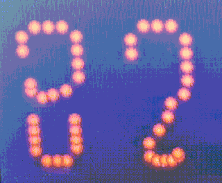
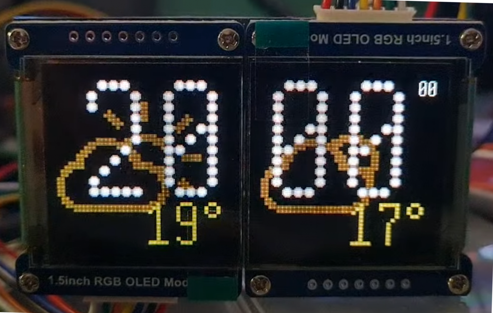
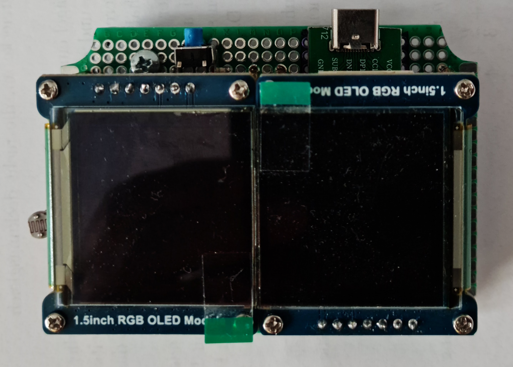
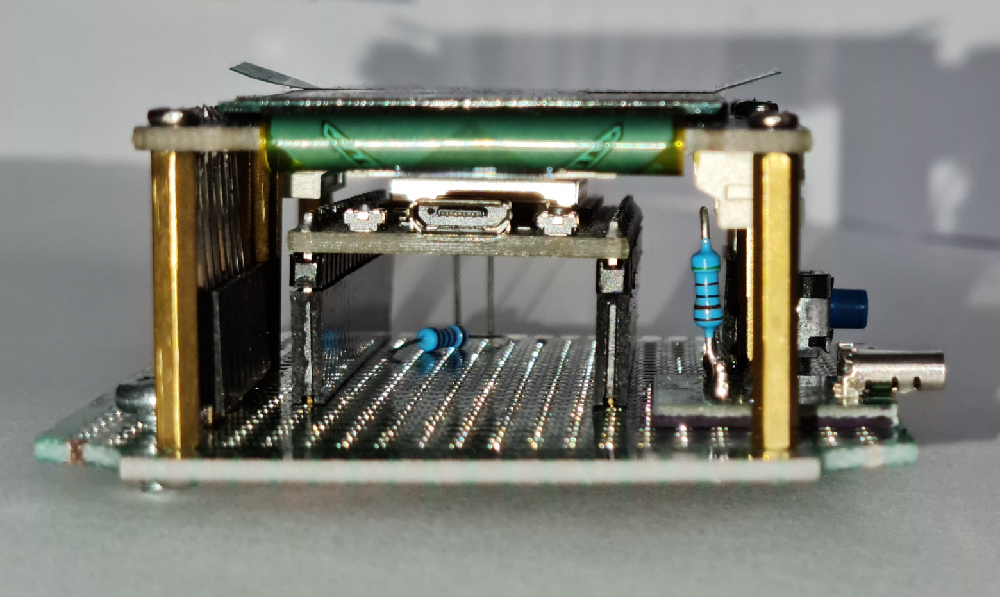
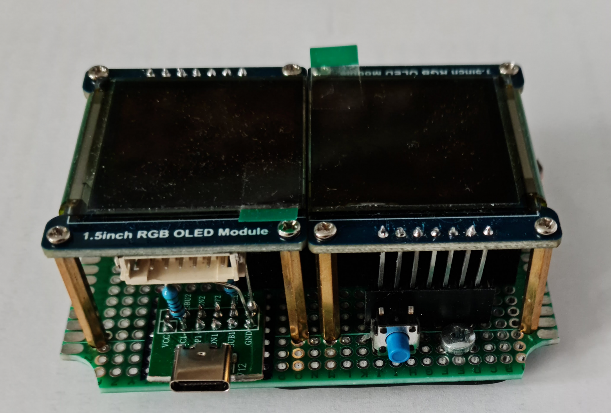
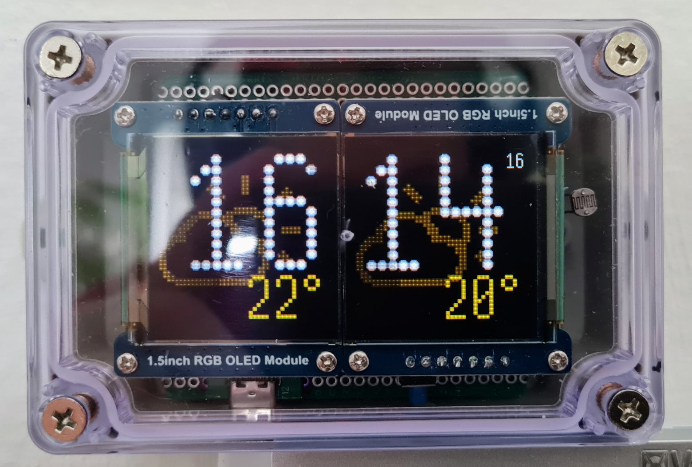

# An Animated Dot-Matrix Font on a Microcontroller

*Translated from the Russian original, first published on [Habr](https://habr.com/ru/articles/817927/).*

Once, looking at a dot-matrix sign, I thought it would be nice if the text changed with an animation. I was curious to try it. A prototype of the animation:

<figure markdown="span">
  
  <figcaption>An animated GIF converted from real video footage</figcaption>
</figure>

At first I thought that realistic animation needed dots that speed up and slow down. But the distance they actually travel on the screen turned out to be short, and the effect was not noticeable at all. On top of that, the final pixel seemed to arrive late. So I dropped the idea. When two characters have different numbers of dots, the dots that disappear gather into the last dot of the new character, and the extra dots start from the last dot of the old one.

**Designing the dot-matrix font**

Each character is described by the coordinates of its dots. I made the first 10 characters, the digits, myself, plus a couple of extra ones for showing degrees. For the weather symbols I started from a font of weather icons and reworked them by hand in the [FontCreator](https://github.com/Llerr/FontCreator) editor. To keep the animation from looking like dots flying at random from one set of coordinates to another, the dots have to be arranged in a certain order: the parts that stay the same keep their places during the transition, and the parts that change should, if possible, cross other dots as little as they can on the way. FontCreator lets you set the index of each dot while you edit a character. In my font each dot is a matrix of 8-bit gray levels. For small sizes I prepared these matrices by hand; above 8 a dot is drawn automatically from filled circles, with brightness falling from the center to the edge.

Although my characters are only 7x14, they scale very well. I used the same font for the large digits and for the smaller ones, and it looked noticeably better than the usual fonts that ready-made microcontroller libraries offer.

**Using it in a clock**

The obvious first place for this font is, of course, a clock. I happened to need a new one anyway, something easy to read from the couch. I had built a clock before, and it was also my [experiment with an animated font](https://youtu.be/7H-2-X1M7PA?si=9Wz3NNVWd9kvu0PC). That one used a Bézier curve font in which every digit was exactly three curves. *Later I developed the idea into an editor for such fonts and effects with them, but never turned it into a finished library.* I have to say that constantly animated seconds are somewhat distracting: your eyes get stuck on them. So in the new clock the seconds get much less space, and you have to come close to see them.

**Morphing**

Morphing one character into another takes several steps. First come two arrays of dot coordinates: one for the character the transition starts from and one for the character it ends on. Then the arrays are brought to the same length: the shorter one is padded with copies of its last element. The morphing function moves each dot along a straight line from its old coordinates to the new ones according to a parameter `t ∈ [0, 1]`, where `t = 0` gives the coordinates of the source character and `t = 1` those of the target character. `t` is computed from the time so that it goes all the way from 0 to 1 in half a second. The start is set half a second before the next second begins.

**Choosing the hardware**

I chose the ESP32 microcontroller because it has Wi-Fi, so the clock can sync with time servers and fetch the current weather and the forecast. The chip is very versatile, powerful and cheap.

I tried several different displays. In the end I concluded that if you want to read the clock at night, backlight glow has to be minimal, ideally none at all. Every hobby display that went through my hands had a bad glow problem, except OLED. Glow becomes an important criterion when the clock is meant to be seen at night, with no light in the room other than the clock itself. Unfortunately, it is hard to find an OLED display with the right size, resolution and price. The resolution should not be too high, since I do not want to spend much memory on the virtual screen. The physical size, on the contrary, should be larger, so the picture can be seen from a distance.

I took advantage of the fact that the information on the screen splits in half: hours on one side, minutes on the other. So the clock face is made of two 1.5" OLED displays, 128x128 each. [OLED SSD1351](https://m.media-amazon.com/images/I/61tp4yL59+L._AC_SX679_.jpg). The time and the temperature are drawn in the foreground, a weather symbol in the background. On the left is the weather "now", on the right the weather "in three hours". The idea with the weather is to see the trend in the morning before going out.

<figure markdown="span">
  
  <figcaption>Test assembly of the two displays</figcaption>
</figure>

I also decided to use a photoresistor to measure the ambient light and adjust the brightness of the picture to it automatically.

**Platform**

The [firmware](https://github.com/jef-sure/dotview-clock) is written in plain C on ESP-IDF, Espressif's own framework. I also used the [mjson](https://github.com/cesanta/mjson) library to parse the responses from the API services. I had to take a third-party library that had not even been ported to the ESP32, because the cJSON component that ships with ESP-IDF could need more memory than was free on the heap when parsing the 16-kilobyte weather forecast response.

For the displays I wrote my own component. I focused on making it general, efficient, lightweight and extensible. Adding a virtual screen whose picture goes to two physical screens at once took a few dozen lines. The frame rate, counting the time to draw everything on the virtual screen first, is about 58.5 fps. The component also supports fonts in various formats, such as BITSTREAM as in the Adafruit libraries, and characters given by the coordinates of dots in a matrix.

It supports Unicode: a program can load only the character sets it needs, and the number of sets has no explicit limit. I keep developing the component as my needs require.

It has drivers for various displays on various buses, with different color depths and memory layouts, as well as virtual screens and combinations of them.

**Operation**

On first power-up the firmware finds that it has no network credentials and shows a QR code for the *ESP SoftAP Provisioning* app, which is available both on Google Play and in the App Store. Once Wi-Fi is set up, the firmware wants to know where it is, to learn its time zone and location so that it shows the right time and weather. Since there is no such data at first, you enter it through a web interface. To turn the web interface on, press the button on the bottom of the clock: the left screen shows a QR code with the website address, and the right screen shows the same address as plain text. Open the address and enter an API key for the weather site [openweathermap.org](https://openweathermap.org/api). Then either enter the location by hand and pick the time zone, or enter an API key for [ipinfo.io](https://ipinfo.io), and the firmware will find its location automatically. As soon as the data is submitted, the web interface turns off and the clock switches to normal mode.

Once the clock knows its location and has set its time zone to match, it polls the weather site regularly and gets the sunrise and sunset times for its location from it. The color of the time digits is computed from them. At night the color should be copper, during the day white, with a smooth transition between the two. The color of the weather symbols and the temperature digits is computed from the temperature. When it is cold, the color shifts toward blue; when it is moderately warm, toward green; hot weather is shown in red. I came up with the formulas for turning temperature into color myself; for some reason there is nothing ready-made anywhere.

**Inside**

All the parts sit on a prototyping board. A ready-made development board similar to the [NodeMCU ESP-WROOM-32](https://www.elektronik-kaufen.ch/products/nodemcu32) is plugged into a socket, with the two displays above it. Power comes in through an external USB-C connector, whose pull-down resistors on the CC lines ask the source for 5 V. There is also a button that turns on configuration through the web interface, and a photoresistor that adjusts brightness to the ambient light. The case is an off-the-shelf project box for homemade devices.

[The project code is on GitHub](https://github.com/jef-sure/dotview-clock), under the MIT license.

**Gallery**

<figure markdown="span">
  
  <figcaption>The displays from above</figcaption>
</figure>

<figure markdown="span">
  
  <figcaption>Inside view</figcaption>
</figure>

<figure markdown="span">
  
  <figcaption>Side view</figcaption>
</figure>

<figure markdown="span">
  
  <figcaption>The assembled clock on the wall</figcaption>
</figure>

<iframe src="https://www.youtube-nocookie.com/embed/1n4Gl04Kc74" title="YouTube" allowfullscreen></iframe>

<iframe src="https://www.youtube-nocookie.com/embed/xkodTHungRY" title="YouTube" allowfullscreen></iframe>

<iframe src="https://www.youtube-nocookie.com/embed/USzqsRKn40w" title="YouTube" allowfullscreen></iframe>

