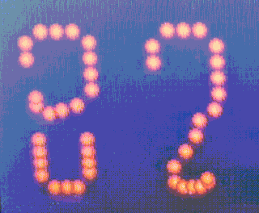
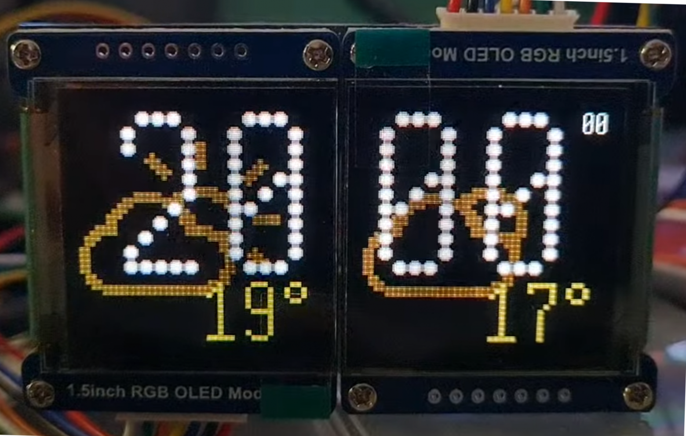
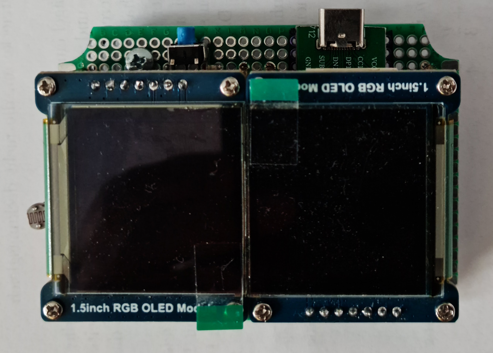
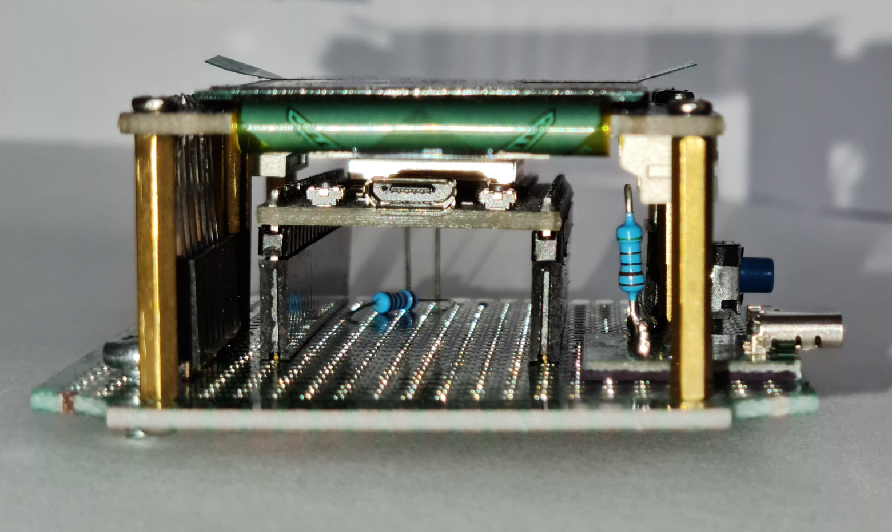
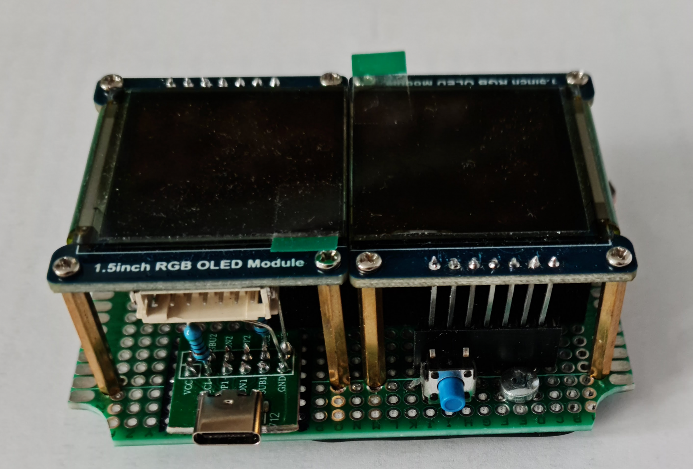
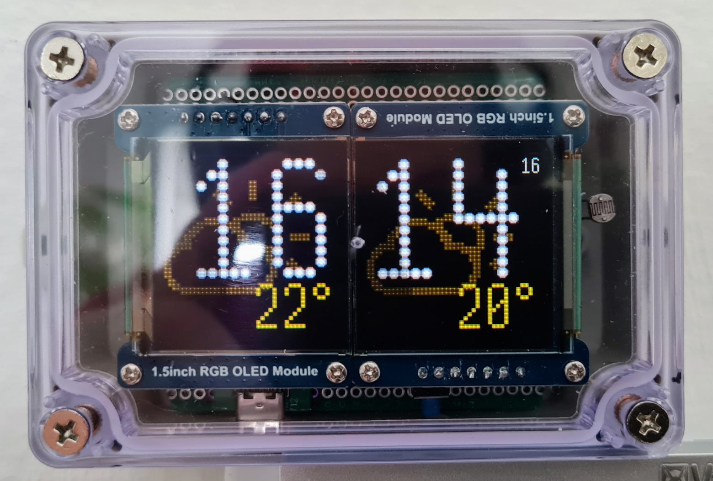

# Матричный шрифт с анимацией на микроконтроллере

*Впервые опубликовано на [Хабре](https://habr.com/ru/articles/817927/).*

Однажды, смотря на матричное табло, я подумал, что было бы не плохо, если бы смена текста была анимированной. Стало интересно попробовать. Прототип анимации.

<figure markdown="span">
  
  <figcaption>Изображение сконвертировано в анимированный GIF из реально снятого видео</figcaption>
</figure>

Изначально думал, что для реалистичной анимации движения точек должны быть с ускорением и торможением, но их реальный ход на экране оказался не таким уж большим и реальный эффект был совсем не заметен, кроме того, финальный пиксель получался как бы с задержкой, поэтому, отказался. Если при переходе между символами количество точек разное, то исчезающие точки складываются в последнюю нового символа, а добавляющиеся идут от последней точки начального символа.

**Разработка точечного шрифта**

Каждый символ описывается координатами точек. Первые 10 символов, представляющих цифры, плюс пара дополнительных для показа градусов, я сделал самостоятельно. За основу символов изображения погоды я взял шрифт, содержащий иконки символов погоды и руками их доработал в редакторе [FontCreator](https://github.com/Llerr/FontCreator). Для того, чтобы анимация символов не выглядела как беспорядочное перемещение точек от одних координат к другим, их необходимо расположить в определённом порядке, чтобы неизменяемые части при переходе оставались на тех же местах, а изменяемые менялись желательно так, чтобы меньше пересекаться с другими точками при движении. FontCreator позволяет при редактировании символа указать индекс каждой точки. Каждая точка у меня это матрица восьмибитных полутонов. Для небольшого размера такие матрицы я подготовил руками, после 8 рисуется автоматически из заполненных кругов понижая яркость от центра к краю.

Не смотря на размеры моих символов 7х14, они очень хорошо масштабируются. Один и тот же шрифт я использовал для больших цифр и для цифр меньшего размера и это смотрелось заметно лучше, чем обычные варианты, предлагаемые готовыми библиотеками для микроконтроллеров.

**Применение в часах**

Первое же место, где можно применить этот шрифт, конечно же - часы. Как раз понадобилось на замену сделать что-то, чтобы было удобно с дивана смотреть. Предыдущий опыт с часами у меня уже был, там тоже был мой [эксперимент с анимированным шрифтом](https://youtu.be/7H-2-X1M7PA?si=9Wz3NNVWd9kvu0PC). Там использовался шрифт на кривых Безье, когда каждая цифра описывалась ровно 3-мя кривыми. *Впоследствии, я развил тему редактора таких шрифтов и эффектов с ними, но так и не воплотил это в какую‑то законченную библиотеку.* Надо сказать, постоянная анимация секунд несколько отвлекает, взгляд прямо таки залипает на ней. Поэтому, в новых часах секундам отведено намного меньше места, надо близко подойти, чтобы их посмотреть.

**Морфинг**

Для анимационного перехода одного символа в другой выполняется несколько шагов. Создаётся два массива координат точек каждого символа: из которого происходит преобразование и в который происходит преобразование. Затем, количество элементов в этих массивах выравнивается, дополняя недостающие элементы размножением последнего элемента в соответствующем массиве. Функция, выполняющая преобразование, расчитывает сдвиг каждой точки по линии от старых координат к новым в зависимости от параметра `t ∈ [0, 1]`, где `t = 0` означает координаты исходного символа, а `t = 1` - координаты конечного символа. Параметр `t` расчитывается по времени так, чтобы весь промежуток от 0 до 1 пройти за половину секунды. Начальная точка отсчёта подбирается за пол секунды до наступления следующей секунды.

**Выбор железа**

Выбрал микроконтроллер ESP32, поскольку у него есть WiFi, что позволяет синхронизировать часы с серверами времени и получать информацию о текущей погоде и прогнозе. Микроконтроллер очень универсальный, мощный и стоит не дорого.

Перепробовал несколько разных дисплеев. В итоге, пришёл к выводу, что если хочется часы смотреть ночью, то засветка должна быть минимальная, а лучше никакая. Все хоббийные дисплеи, что прошли через мои руки, имели сильную проблему засветки, кроме OLED. Засветка становится важным критерием, когда часы планируется видеть ночью, когда никакого другого света, кроме как от часов, нет. К сожалению, с OLED дисплеями проблема, что трудно найти подходящий по размеру, разрешени и цене. Разрешение дисплея не должно быть сильно большим, памяти на виртуальный экран не хочется тратить много, размеры же, наоборот, хочется побольше, чтобы можно было изображение издалека видеть.

Я воспользовался тем, что информация на экране может быть разделена пополам -- с одной стороны часы, с другой минуты. Таким образом, экран часов состоит из двух OLED дисплеев размером 1,5" и разрешением 128х128 каждый. [OLED SSD1351](https://m.media-amazon.com/images/I/61tp4yL59+L._AC_SX679_.jpg). На переднем фоне пишется время и температура, на заднем фоне рисуется символ погоды. Слева погода "сейчас", справа погода "через три часа". С погодой идея в том, чтобы утром увидеть тренд перед выходом на улицу.

<figure markdown="span">
  
  <figcaption>Экспериментальная сборка из двух дисплеев</figcaption>
</figure>

Дополнительно решил воспользоваться фоторезистором для замера окружающей освещённости, чтобы автоматически подстраивать яркость изображения под освещённость.

**Платформа**

[Программа](https://github.com/jef-sure/dotview-clock) написана с использованием фирменного фреймворка ESP-IDF от Espresiff на чистом Си. Так же использовалась библиотека [mjson](https://github.com/cesanta/mjson) для разбора принятых ответов от API сервисов. Пришлось воспользоваться сторонней даже не портированной на ESP32 библиотекой, поскольку поставляемый вместе с ESP-IDF компонент cJSON при разборе ответа прогноза погоды объёмом 16 килобайт мог потребовать больше памяти, чем было свободно в куче.

Для работы с дисплеями я написал свой собственный компонент. При написании упор был на универсальность, эффективность, лёгкость и расширяемость. Добавление виртуального экрана, изображение с которого выводится на два физических экрана одновременно, заняло несколько десятков строк. Частота кадров с учётом, что информацию надо сначала нарисовать на виртуальном экране, состаяляет примерно 58,5 кадров/сек. Компонент поддерживает так же шрифты представленные в различных форматах, типа BITSTREAM, как в библиотеках от Adafruit, а так же символы, заданные координатами точек в матрице.

Поддерживается кодировка символов Unicode, в программе могут быть загружены только необходимые наборы символов, количество наборов явно не ограничено. Компонент находится в постоянном развитии согласно моим потребностям.

Поддерживаются драйвера разных дисплеев на разных возможных шинах, с разной глубиной цвета и организацией памяти, виртуальные экраны и их комбинации.

**Функционирование**

При первом включении программа обнаружит, что нет данных для подключения к сети и выведет QR-код для программы *ESP SoftAP Provisioning*, которая есть как в Google Play Market, так и в App Store. После настройки Wifi программа захочет получить данные о своём местоположении, чтобы узнать временную зону и местонахождение, чтобы правильно показывать время и погоду. Поскольку данных изначально нет, их надо ввести через веб-интерфейс. Для включения веб-интерфейса надо нажать кнопку снизу часов, на левом экране появится QR-код с адресом вебсайта, а на правом этот же адрес в обычной символьной форме. Пройдя по адресу и заполнив данные по ключу API от сайта погоды [openweathermap.org](https://openweathermap.org/api), а так же либо руками введя местоположение и выбрав временную зону или ввести ключ от API [ipinfo.io](https://ipinfo.io), тогда программа будет определять своё местоположение автоматически. Сразу после отправки данных веб-интерфейс выключается и часы переходят в обычный режим.

Определив своё местоположение и подстроив соответственно временную зону, часы регулярно опрашивают сайт погоды, по информации от которого получают время восхода и заката для местоположения. От этого вычисляется цвет цифр времени. Ночью цвет должен быть медным, днём белым, переход от одного к другому плавный. Цвет символов погоды и цифр температуры вычисляется от температуры. Когда холодно, то цвет уходит в синий; когда умеренно тепло, то зелёный; жаркая погода показывается красным. Формулы преобразования температуры в цвет придуманы самостоятельно, почему-то нигде ничего готового нет.

**Внутреннее устройство**

Все компоненты установлены на макетной плате. Готовая плата разработчика похожая на [NodeMCU ESP-WROOM-32](https://www.elektronik-kaufen.ch/products/nodemcu32) установлена в кроватку, над платой находятся два дисплея. Питание осуществляется через внешний USB-C разъём. Резисторами выставлен режим потребления 5В. Дополнительна установлена кнопка для включения режима конфигурирования через веб-интерфейс и фоторезистор для подстройки яркости под окружающее освещение. Использовался готовый корпус для самодельных устройств.

[Код проекта выложен на github](https://github.com/jef-sure/dotview-clock), лицензия MIT.

**Галерея**

<figure markdown="span">
  
  <figcaption>Дисплеи сверху</figcaption>
</figure>

<figure markdown="span">
  
  <figcaption>Вид изнутри</figcaption>
</figure>

<figure markdown="span">
  
  <figcaption>Вид сбоку</figcaption>
</figure>

<figure markdown="span">
  
  <figcaption>Вид часов в сборе на стене</figcaption>
</figure>

<iframe src="https://www.youtube-nocookie.com/embed/1n4Gl04Kc74" title="YouTube" allowfullscreen></iframe>

<iframe src="https://www.youtube-nocookie.com/embed/xkodTHungRY" title="YouTube" allowfullscreen></iframe>

<iframe src="https://www.youtube-nocookie.com/embed/USzqsRKn40w" title="YouTube" allowfullscreen></iframe>

