# Hard pen, soft pen

The clock on the CYD (the Cheap Yellow Display, an ESP32 development board)
writes the city name in the handwritten font: "Neustadt an der Weinstraße" in
a 320×46 band of the screen. A lowercase letter there is 12 pixels tall, a
capital 25, and the line is 2 pixels wide. The top line below is drawn with
the hard pen, the bottom one with the soft pen; both are twice as large as on
the board.

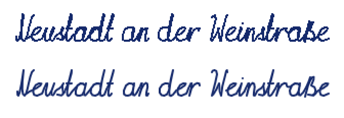

The subject grew out of two earlier articles: "[A Bézier Curve Font on a
Microcontroller](../bezier-font-en/index.md)", about a font made of curves,
and "[Bringing Text to Life on an ESP32](../living-water-en/index.md)", about
the handwritten font and this clock.

This is how the DGX library draws a line like that, and what makes the soft
pen different from the hard one. The same story with all the measurements and
the details of the code is in [pen-en.md](../../dgx/pen-en.md).

## A screen made of cells

The CYD screen is 320 pixels wide and 240 tall, 2.8 inches across the
diagonal. Each pixel is a tiny square about 0.18 mm on a side, and it has one
color over its whole area. A line that would be smooth on paper has to be
assembled from these squares.

The simplest rule is to paint a pixel if its center falls inside the line. In
the picture, the red outline is a 3-pixel line as it would look on paper, and
the dots are the pixel centers.

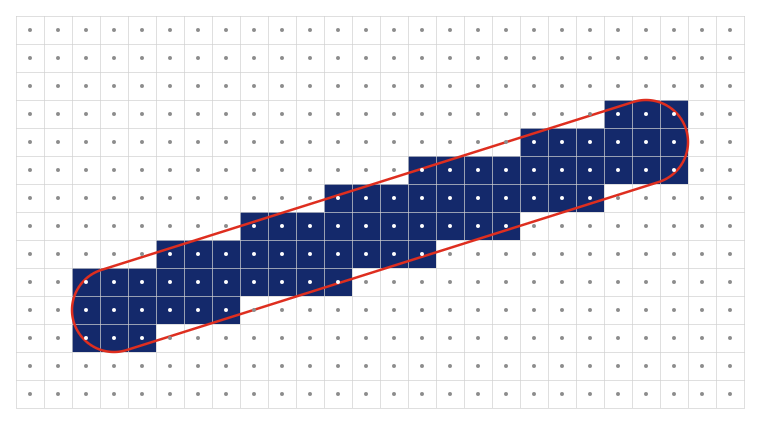

The edge comes out as a staircase. On a thick line a step is small next to
the width, but on a 2-pixel line it is half the width. Here is the word "Wein"
from the city name, hard pen on the left, soft pen on the right:

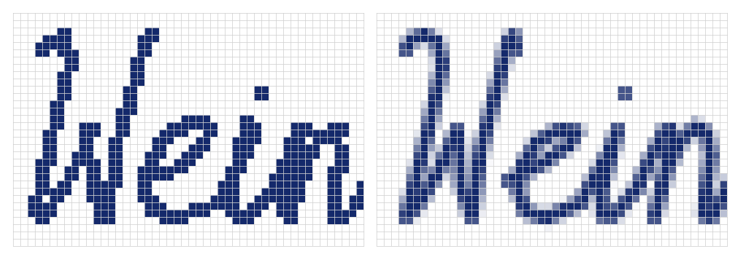

## A curve from straight pieces

When I was designing the handwritten font, I chose Bézier curves as the basic
kind of line. Most of them are four-point curves, and computing those means a
cubic polynomial. Three-point curves need only a quadratic one, but their
shape is much more limited, and the same outline takes more of them. To draw
a curve, I approximate it with straight segments, chosen so that none of them
strays more than half a pixel from the part of the curve it stands for. Plain
straight segments then draw a complicated curve that looks perfectly smooth
on the screen. The font editor works out the number of segments for every
curve in advance. At drawing time that number is adjusted to the scale,
ceil(segments × √scale), and the same number tells how much work the writing
will take.

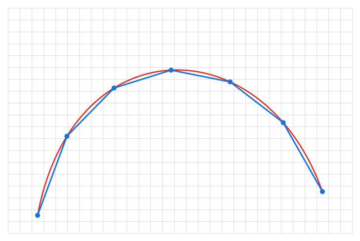

The red line is the curve, the blue one a polyline of 6 segments.

## How the pen draws a segment

### The segment's own coordinates

Screen coordinates start in the top left corner: x is the pixel column and
grows to the right, y is the row and grows downward. In a school notebook the
y axis points up, but on a screen it points down: rows are numbered from the
top, like lines of text on a page. A point with whole coordinates (x, y) is
the center of the pixel in column x, row y.

A pen has a width w and a color. To decide whether to paint a pixel, you need
to know how far its center is from the segment. A thick segment is a
rectangle w wide with the segment itself running down its middle, w / 2 to
each side. Checking a point against an upright or a level rectangle is easy;
against a rectangle turned at an arbitrary angle, not so much. The trick is
to move the origin to point A, where the rectangle starts, and turn the axes
so that x runs along the segment and y across it. In these coordinates x' is
how far along the segment from A you have to go to be level with the point,
and |y'| is the distance from the point to the line the segment lies on.

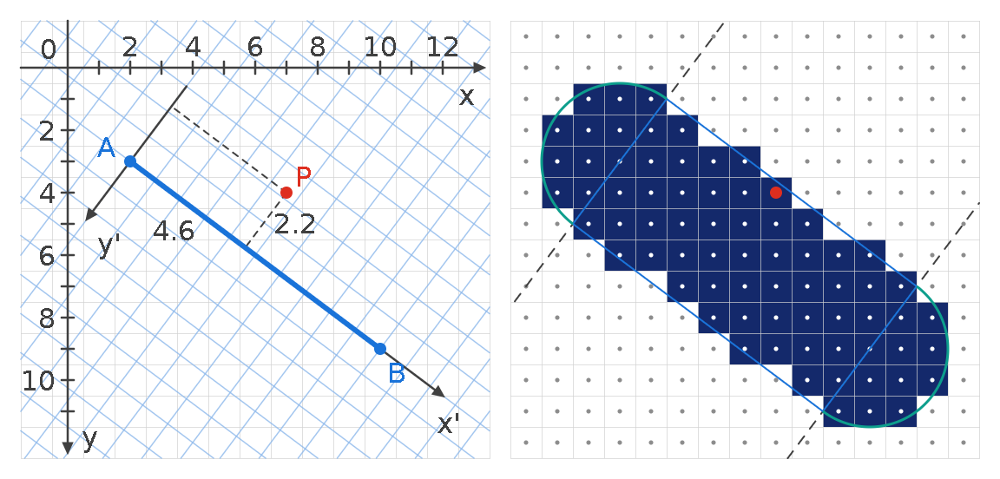

Moving the origin is plain subtraction: x − Ax and y − Ay. Then the axes are
turned by the angle θ of the segment, which turns the point by −θ relative to
them:

```
x' =  (x − Ax) · cos θ + (y − Ay) · sin θ
y' = −(x − Ax) · sin θ + (y − Ay) · cos θ
```

From the right triangle, cos θ = (Bx − Ax) / L and sin θ = (By − Ay) / L,
where L is the length of the segment. No trigonometry is needed: cos θ is how
far the segment moves in x per pixel of its length, and sin θ how far it
moves in y. Both are computed once per segment.

The example from the picture: A = (2, 3), B = (10, 9). The segment goes 8
pixels right and 6 down, so L = 10, cos θ = 0.8, sin θ = 0.6. The light blue
grid in the picture is the new coordinate system. Point P = (7, 4) becomes
(5, 1) after the move, and after the turn:

```
x' =  5 · 0.8 + 1 · 0.6 =  4.6
y' = −5 · 0.6 + 1 · 0.8 = −2.2
```

So P is level with the point of the segment 4.6 pixels from A, and 2.2
pixels away from the line AB; the minus means it lies on the side opposite to
where the y' axis points.

### A rectangle and two half-discs

The pen line along a segment is every point within w / 2 of the segment. In
the segment's coordinates it is easy to describe; it is drawn in the right
half of the picture above, where the dashed lines are x' = 0 and x' = L.

If 0 ≤ x' ≤ L, the nearest point of the segment is straight across from P,
and the distance to the segment is |y'|. Here the line is a rectangle L long
and w wide, and two inequalities tell whether a point is inside:

```
0 ≤ x' ≤ L
−w/2 ≤ y' ≤ w/2
```

If x' < 0, the nearest point of the segment is its start, A. The points of
the line there are within w / 2 of A, which makes half a disc centered on A.
If x' > L, the same goes for B. A rectangle and two half-discs make up the
whole line, and its ends come out round on their own.

For P from the example, 0 ≤ 4.6 ≤ 10 and |−2.2| ≤ 2.5: the point is inside
the line of a 5-pixel pen, and its pixel gets painted.

The hard pen paints a pixel if its center is inside the line. Testing every
pixel of the screen like that, one by one, would be slow, so the pen works
row by row. For a row, the same inequalities give an interval from a left
boundary to a right one, and everything between them is painted in one go.

### Joints

A curve is made of many segments. If you draw only the rectangle of each, a
gap opens on the outer side of every bend (the red triangle in the left
picture). The half-discs close it. At a joint, the half-disc at the end of one
segment and the one at the start of the next sit around the same point, and a
single whole disc covers both. So the pen draws a rectangle for each segment
and a whole disc at its end, plus one more disc at the start of the first
segment of a curve.

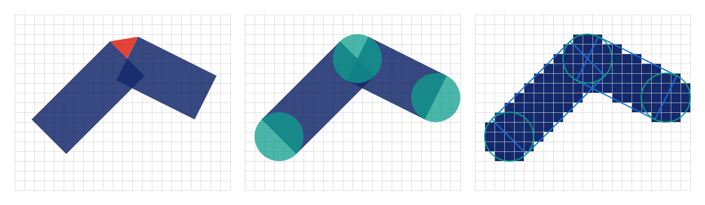

At first the discs at the joints were drawn separately, and they took 33 to
48% of the time spent on a letter. Now a rectangle and the disc at its end
are a single figure, shaped like a bullet. Every pixel row of it is one
unbroken interval, and the pen paints it in one go.

## The soft edge

### A share of a pixel

The hard pen either paints a pixel completely or leaves it alone. The soft
pen paints a pixel as much as the line covers it: if the line covers half of
the pixel, the pixel gets half the ink; a quarter, a quarter of the ink.

A cross-section shows it best. A horizontal 2-pixel line runs with its middle
0.3 pixel below the center of pixel 4, at y = 4.3, so its edges are at
y = 3.3 and y = 5.3. Pixel 3 spans 2.5 to 3.5 vertically, and the line covers
0.2 of it; pixel 5 spans 4.5 to 5.5, and 0.8 of it is covered.

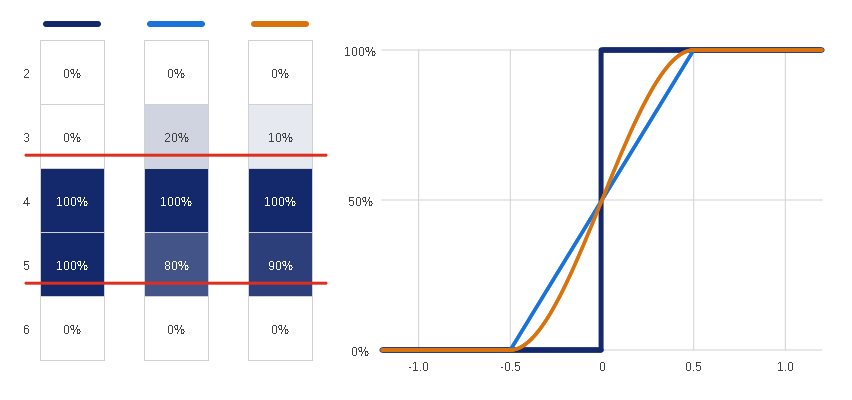

On the left are pixels 2–6 of one screen column; the red lines are the edges
of the line, and the bar above each column has the color of its rule on the
graph. The first column is the hard pen, the second the soft pen, the third
smoothstep, which comes up below. On the right are the same three rules as a
graph: across, how deep the pixel center is inside the line, in pixels (0 is
right on the edge, negative is outside); up, the share of ink.

The soft pen gets the share from the distance d between the pixel center and
the segment: |y'| alongside the segment, and the distance to A or B beyond
its ends.

```
share = 0.5 + w/2 − d, clamped to 0…1
```

For pixel 3 in the cross-section, d = 4.3 − 3 = 1.3, and the share is
0.5 + 1 − 1.3 = 0.2; for pixel 5, d = 0.7 and the share is 0.8. On the graph
this is the blue straight line:

- the center is exactly on the edge of the line, d = w/2: 50%;
- the center is half a pixel or more inside: 100%;
- the center is half a pixel or more outside: 0%;
- in between, the share changes along a straight line.

When the edge runs along pixel rows or columns, as in the cross-section, this
is exactly the part of the pixel's area under the line. When the edge runs at
a slant, it is very nearly that:

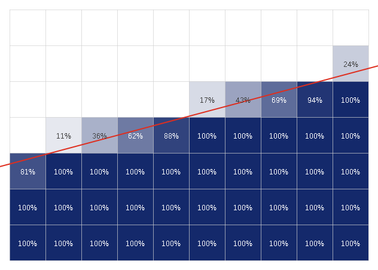

The red line is the top edge of a thick line; each cell shows the share of
ink the soft pen gave that pixel.

The soft pen computes x' and y' for every pixel near the segment, and it does
so without a single multiplication. From the rotation formula, a step one
pixel to the right adds cos θ to x' and subtracts sin θ from y', and a step
one row down adds sin θ to x' and cos θ to y'.

At a normal viewing distance you can't see individual pixels; the eye sees
their average brightness. A half-painted pixel looks like an edge running
through its middle. So the edge of a soft line shows up where it should be,
more precisely than a pixel, and the steps are almost invisible: look at the
right half of the enlarged "Wein" above.

### Four variants

The soft edge first came in four variants. I compared them by eye on city
names in the clock's band, with a 2-pixel pen:

1. **Hard**: the hard pen, for comparison.
2. **Hard figure**: the hard pen's figure with a soft edge. All points are
   whole, as with the hard pen, and for an even width the axis is shifted half
   a pixel to the right of the direction of travel, again as with the hard
   pen. This was the first one made.
3. **Points as they are**: the ends of the polyline's segments aren't
   rounded; only the ends of the curve itself are whole. The share comes from
   the formula above.
4. **Smoothstep**: the same, but the share goes through
   share² × (3 − 2 × share). The edge gets steeper in the middle and gentler
   near 0 and 1: the orange curve on the cross-section graph.
5. **All fractional**: the control points of the curve aren't rounded either.
6. **Yardstick**: the line drawn with the hard pen 8 times larger and scaled
   down by averaging every 8×8 square of pixels. That way each pixel gets
   almost exactly the part of its area the line covers, but the 320×46 band
   needs a buffer of nearly a megabyte.
7. **Now**: the library's soft pen as it is today, for comparison.

Below are three names from that comparison and one phrase, twice as large as
on the board.

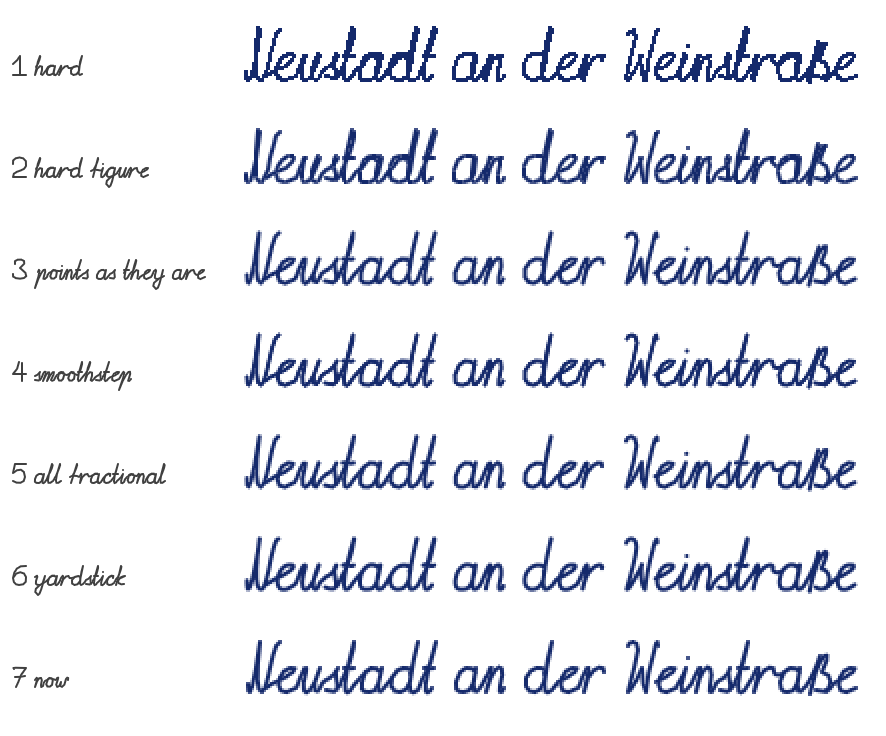

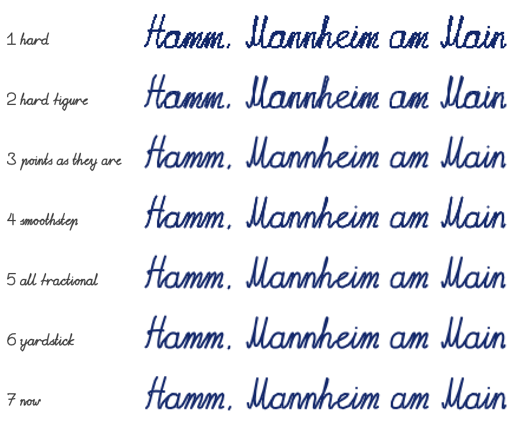

The letters "amm" from the same line under a magnifier:

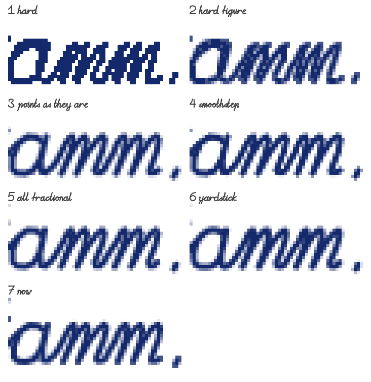

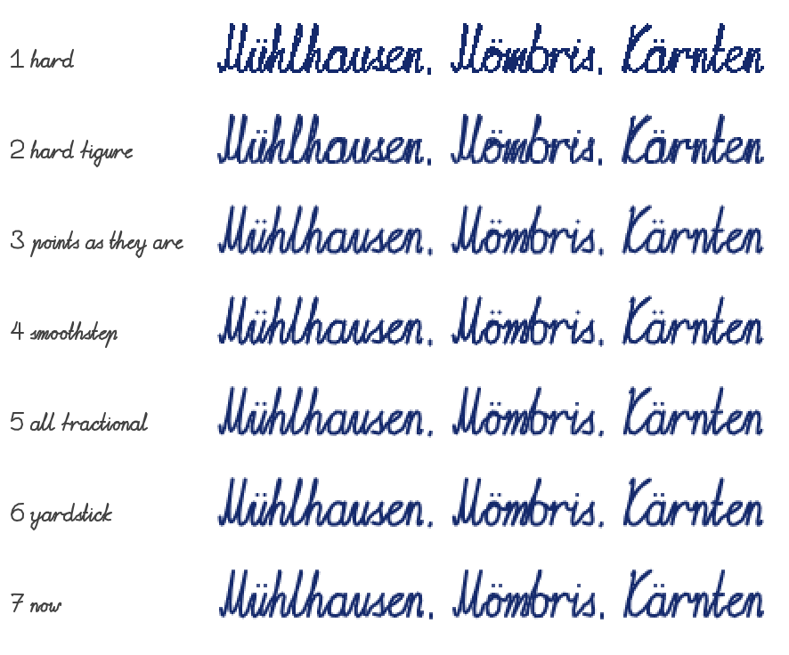

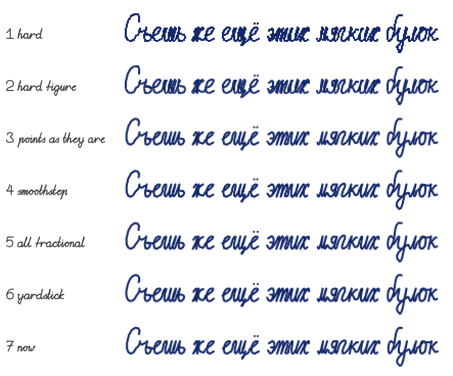

The last one is a shortened Russian pangram, our quick brown fox: "Have some
more of these soft rolls".

The library no longer draws variants 2–5. The pictures compute them again by
the same rules, with the current font.

How much ink each line takes in each variant; "pixels of ink" is the sum of
the shares of all its pixels:

| Variant | Neustadt… | Hamm… | Mühlhausen… | Съешь… |
| ------- | --------- | ----- | ----------- | ------ |
| 1       | 2387      | 2305  | 2565        | 2358   |
| 2       | 2286      | 2206  | 2456        | 2250   |
| 3       | 2070      | 2004  | 2244        | 2059   |
| 4       | 2071      | 2003  | 2247        | 2060   |
| 5       | 2068      | 1996  | 2224        | 2071   |
| 6       | 2113      | 2033  | 2279        | 2141   |
| 7       | 2069      | 1999  | 2240        | 2056   |

### The choice

Every soft variant reads better than the hard pen. Variant 2 is the heaviest
of them: 10% more ink than the rest, and the legs of the "m" run together.
The culprit is the shifted axis. The hard pen shifts the axis of an even line
half a pixel to the right of the direction of travel, and which way "right"
is depends on the direction of the segment. In an "m" the pen goes over the
first two legs twice: down, and then straight back up to the next arch. For
those two passes "right" points in opposite directions. The axes of the two
passes end up more than a pixel apart, and a leg 2 pixels thick grows thicker
than 3.

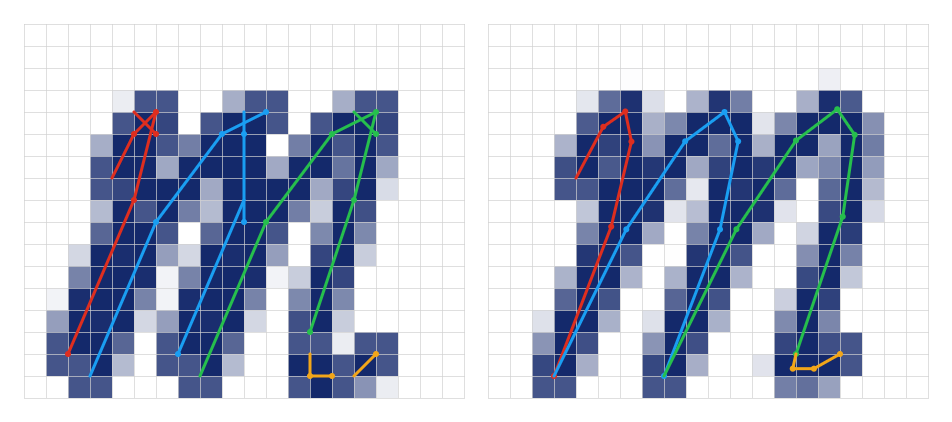

The letter "m" at the clock's size, magnified. The lines are the axes of the
segments, one color per stroke. On the left is variant 2: the red stroke goes
down the first leg, the blue one back up the same leg, and their axes have
drifted apart. On the right is the current pen: the axes of the two passes
coincide.

Without the shift, the same figure puts 2062 pixels of ink into the city
name, in line with variants 3–5.

Whole points make a line uneven. Rounding moves each end of a segment up to
half a pixel sideways, the polyline zigzags around the curve, and the line
gets thicker and thinner by turns, lying in shelves on the gentle stretches.
The soft pen has no use for whole points: it gets the share of a pixel from
its distance to the segment.

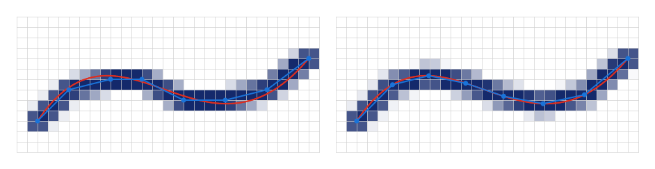

A curve drawn with a 2-pixel soft pen. On the left the segment ends are
rounded, on the right they are left as they are; the red line is the curve,
the blue one the polyline. The library doesn't draw the left version: it is
the same segments drawn one at a time with the soft pen between rounded
points.

Variants 3, 4 and 5 are hard to tell apart. Smoothstep changes the share of a
pixel by no more than a tenth of its ink (see the cross-section graph): with a
2-pixel pen that's barely visible, and with a thick pen, where the edge is a
small part of the line, even less so. Fractional control points change the
ink by a fraction of a percent, and the drawing functions would need
different arguments. I chose variant 3: it has the most readable "m".

After the choice two things changed in it, and that is how variant 7 came
about. A soft line of even width is shifted half a pixel right and down, the
same way along its whole length; see "Even widths". And a segment is drawn
not as a bullet but as a bar with its ends cut square, which is what the next
section is about.

## Where the pieces meet

The soft pen's figures are a little different. A segment is a bar with
square-cut ends. At a joint with a sharp turn, a wedge of a disc fills the
space between the bars; where the turn is small, the two bars simply meet in
a corner. But like the bullets of the hard pen, these figures overlap at the
joints.

The hard pen doesn't care: a pixel painted twice is still the same pixel.
The soft pen does. If the shares added up, the semi-transparent edge would
get ink twice at every joint, and the line would grow knots. So a pixel keeps
the larger of two numbers: what is already in it and what the pen brings.
Joints and crossings don't get darker, and a line drawn twice stays the same
line.

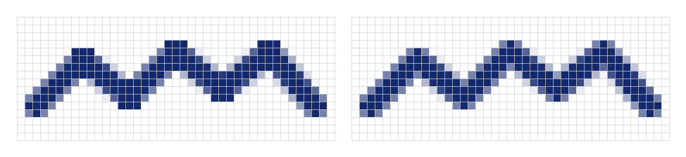

A polyline of 6 segments with a 3-pixel pen, each segment drawn separately
with its own round ends. On the left the shares are added up, on the right
the larger one is kept.

## A pixel as an amount of ink

To keep the larger value, the pen has to read what is already in the pixel,
and that has to be an amount of ink, not a color. In DGX such a pixel lives
in a virtual screen with one byte per pixel: a screen in the
microcontroller's memory where every pixel is a number from 0 to 255. 0 is
paper, 255 is a fully covered pixel, and everything in between is a share.

The numbers get their colors on the way to the display: a table turns each
of them into a color between the paper color and the ink color. The same
bytes can be shown in any pair of colors. Above each line is its table, from
0 on the left to 255 on the right:


Other screens have no soft pen. A 16-bit pixel holds a color, not an amount,
and the library can't read back a display at the other end of the wires.
There a pen asked to be soft draws as a hard one of the same width.

## Even widths

A 3-pixel line has a middle pixel, and the point of the curve is its center.
A 2-pixel line has no middle pixel. A dot from a 2-pixel soft pen centered on
a pixel covers that pixel fully and its four neighbors by half, which makes a
little cross. That is exactly how the dot over the "i" looked, and the two
dots over the "ö" ran into each other.

So a soft line of even width is shifted half a pixel right and down. A whole
point then falls on the corner between four pixels, and the dot of a 2-pixel
pen becomes a 2×2 square with 79% ink in each pixel. The hard pen puts its
dot in the same place. The shift is the same along the whole line, whichever
way it goes, so the axes of the passes there and back don't drift apart, as
they did in variant 2.

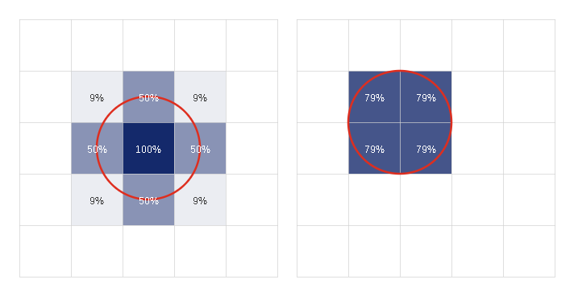

The red circle is the dot of the pen, 2 pixels across. On the left its center
is in a pixel: the library doesn't draw it that way, the shares are computed
by the same rule for the picture. On the right the center is on the corner of
four pixels, as the library draws it.

## Erasing

A pen of color 0 erases. A soft pen of color 0 has a rule of its own: every
pixel the line would give any ink at all becomes zero. A soft pen going the
same way removes a soft line completely.

A hard pen of color 0 removes only the pixels of a hard line. Of a soft line
it leaves the edges, and in places whole pixels: a hard line has whole
points, and it shifts the axis of an even pen its own way, so it doesn't lie
exactly where the soft one does.

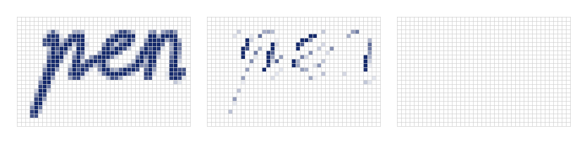

On the left, the word "pen" written with a 2-pixel soft pen. In the middle,
the same after a hard pen of color 0 along the same path; on the right, after
a soft one.

## Which is faster

I expected the soft pen to be slower: it has to work out a share for every
pixel. It turned out otherwise, because the two pens spend their time on
different things. The hard pen pays per row of a figure: about a microsecond
a row, however many pixels are in it. The soft pen pays per pixel: inside a
long segment a pixel costs 26 nanoseconds, and on the edge of a disc four
times that, because there it needs a square root. In small text the rows are
short and almost all of the soft pen's pixels are on edges, so the hard pen
is faster. In large text the rows are long, the soft pen's pixels are mostly
inside bars, and the soft pen is faster.

Drawing time on the CYD (ESP32, 240 MHz) into an 8-bit screen in memory,
without sending anything to the display, in milliseconds. Measured on DGX
0.10.15 with the code of the font and the pen in IRAM
(CONFIG_DGX_HW_FONT_IN_IRAM and CONFIG_DGX_BEZIER_IN_IRAM). A line of text
is about 50 pixels tall at scale 0.25 and 202 pixels at scale 1.

| What                                     | Hard | Soft |
| ---------------------------------------- | ---- | ---- |
| City name, pen 2                         | 3.56 | 3.82 |
| "The quick brown fox", scale 0.25, pen 3 | 3.02 | 3.38 |
| The same, scale 1, pen 9                 | 7.77 | 4.55 |

The first version of the soft pen took almost twice as long as the hard one
on the city name, 14.7 ms against 8.5. Most of that turned out to be not the
pen at all but the way its code and the font tables landed in the flash
cache; how that was found and fixed is told in pen-en.md, in "[The flash
cache](../../dgx/pen-en.md#the-flash-cache)".

By default this code lives in flash and is read through the cache, and then
the time also depends on how the code and the font tables happened to land
in the cache in a particular build. The same lines from flash in versions
0.10.13–0.10.15: the city name 4.25–4.83 ms with the hard pen and 4.48–5.49
with the soft one, small text 3.49–3.78 and 3.84–4.43, large text 8.41–8.78
and 5.03–5.61. Which pen is faster where doesn't change.

## In code

The kind of pen is chosen at every drawing call, together with the width:
DGX_PEN_SOFT | 2 is a 2-pixel soft pen, plain 2 a hard one. The soft pen
needs a screen with one byte per pixel, and the color is an amount of ink,
from 0 to 255.

```c
dgx_screen_t *band = dgx_vscreen_init(320, 46, 8, DgxScreenRGB);
dgx_hw_draw_text(band, x, y, font0ss(), "Neustadt an der Weinstraße", scale, DGX_PEN_SOFT | 2, 255, true);
dgx_vscreen8_to_screen16(lcd, 0, 0, band, lut, 0);
```

lut is a table of 256 colors running from the paper to the ink.

The hard pen is still in the library. It never needs to read back what has
been drawn, so it draws straight onto the display, with no screen in memory.
That makes it the one to use when there isn't enough memory for a virtual
screen.

## What came of it

Soft edges make curves look noticeably nicer than hard ones, especially on
small screens: it's as if they add resolution. But even on bigger screens,
like a 7" 1024×600 or even a 10" 1280×800, the difference is still easy to
see. In the end DGX got not only the soft pen for curves, but also thick
straight segments with soft edges, a soft edge for filled circles, and
soft edges for fonts.
