# Перо и мягкое перо

Часы на плате CYD (Cheap Yellow Display — ESP32 Development Board)
пишут название места рукописным шрифтом:
«Neustadt an der Weinstraße» в полосе экрана 320 на 46 пикселей. Строчная
буква там высотой 12 пикселей, заглавная 25, линия толщиной 2 пикселя.
Верхняя строка нарисована резким пером, нижняя мягким; обе вдвое крупнее,
чем на плате.

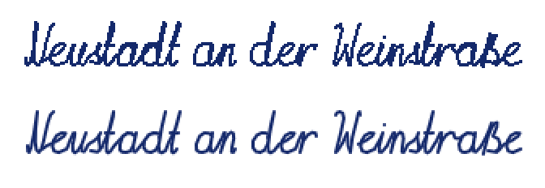

Тема выросла из двух прежних статей: «[Шрифт на кривых Безье на
микроконтроллере](../bezier-font-ru/index.md)» — о шрифте из
кривых, и «[Живая вода для ESP32: рукописный шрифт и
морфинг](../living-water-ru/index.md)» — о рукописном шрифте и
об этих часах.

Здесь описано, как библиотека DGX рисует такую линию и чем мягкое перо
отличается от резкого. То же с замерами и подробностями кода — в
[pen-ru.md](../../dgx/pen-ru.md).

## Содержание

- [Экран из клеток](#экран-из-клеток)
- [Кривая из прямых кусков](#кривая-из-прямых-кусков)
- [Как перо рисует отрезок](#как-перо-рисует-отрезок)
- [Мягкий край](#мягкий-край)
- [Где куски встречаются](#где-куски-встречаются)
- [Пиксель как количество чернил](#пиксель-как-количество-чернил)
- [Чётная толщина](#чётная-толщина)
- [Стирание](#стирание)
- [Что быстрее](#что-быстрее)
- [В коде](#в-коде)

## Экран из клеток

Экран CYD — 320 пикселей в ширину и 240 в высоту, 2,8 дюйма по диагонали.
Пиксель на нём — квадратик со стороной около 0,18 мм, и цвет у него один на
всю площадь. Линию, которая на бумаге была бы гладкой, на экране приходится
набирать из таких квадратиков.

Самое простое правило: пиксель закрашивается, если его центр попал внутрь
линии. На картинке красным обведена линия толщиной 3 пикселя, какой она была
бы на бумаге, точки — центры пикселей.

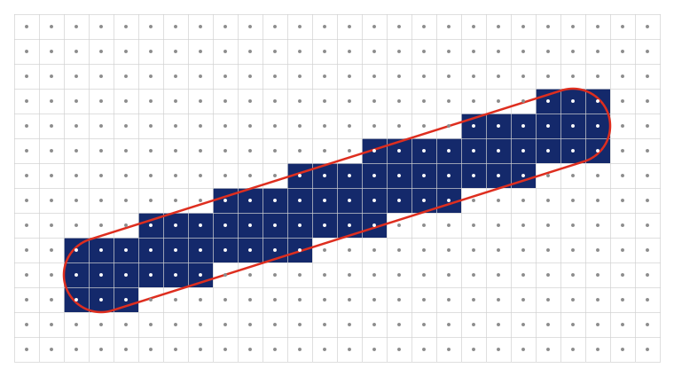

Край вышел ступеньками. У толстой линии ступенька мала по сравнению с
толщиной, у линии в 2 пикселя она равна половине толщины. Вот слово «Wein»
из названия места, слева резкое перо, справа мягкое:

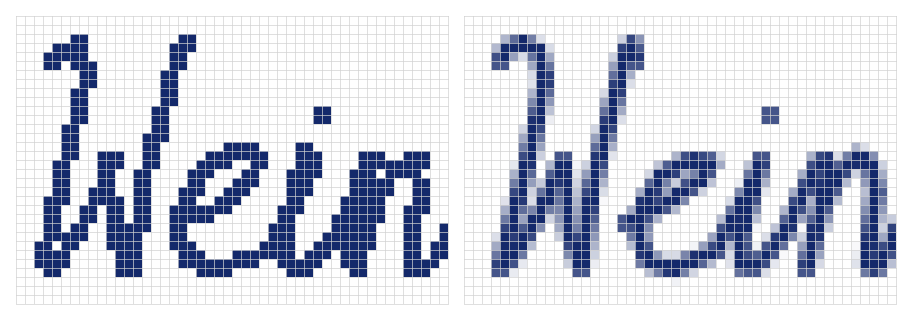

## Кривая из прямых кусков

При разработке рукописного шрифта в качестве базового типа линии я выбрал
кривые Безье. В основном это кривые по четырём точкам, и для их расчёта
требуется вычислять кубический полином. Для кривых Безье по трём точкам
надо вычислять квадратный полином, но форма кривой становится сильно
ограниченной и надо больше кривых использовать на ту же форму. Чтобы
нарисовать кривую, я использовал её приближение прямолинейными отрезками.
Отрезки рассчитываются так, чтобы отклонение от участка кривой, на котором
они рисуются, было не более половины пикселя. В результате простыми
прямыми отрезками рисуется сложная кривая, которая на экране выглядит
совершенно плавной. Количество отрезков для каждой кривой посчитано заранее
в редакторе шрифтов. При рисовании оно пересчитывается под масштаб,
`ceil(отрезков × √масштаб)`, и по нему же считается трудоёмкость письма.

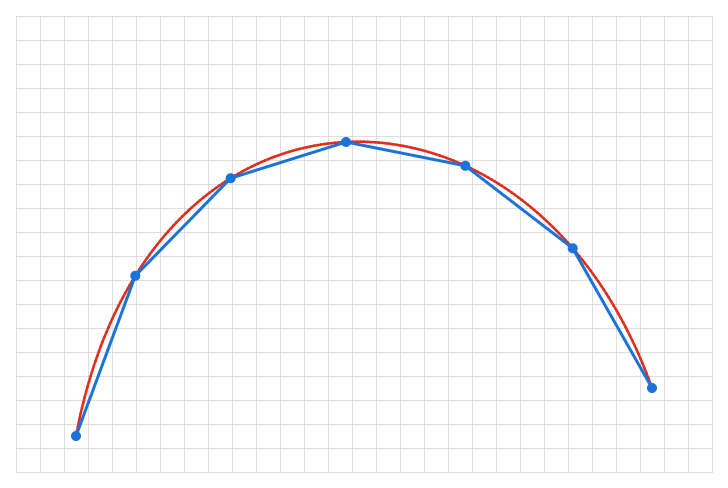

Красная линия — кривая, синяя — ломаная из 6 отрезков.

## Как перо рисует отрезок

### Система координат отрезка

Координаты на экране отсчитывают от левого верхнего угла: `x` — номер
столбца пикселей, он растёт вправо, `y` — номер строки, он растёт вниз. В
школьной тетради ось `y` смотрит вверх, а на экране вниз: строки нумеруются
сверху, как строки текста на странице. Точка с целыми координатами `(x, y)` —
центр пикселя в столбце `x` и строке `y`.

Перо задаётся толщиной `w` и цветом. Чтобы решить, закрашивать ли пиксель,
надо знать, далеко ли его центр от отрезка. Отрезок — толстая прямая линия,
прямоугольник шириной `w`, средняя линия которого — сам отрезок: в каждую
сторону от неё лежит по `w / 2`. Очень легко проверить, когда прямоугольник
расположен вертикально или горизонтально, но произвольно повёрнутый
прямоугольник проверить сложнее. Для этого надо перенести начало координат
в точку `A`, где начинается прямоугольник, и повернуть ось `x` вдоль
линии, проходящей через центр прямоугольника, а ось `y` — поперёк неё.
В новой системе координат `x'` точки — сколько надо пройти вдоль отрезка
от `A`, чтобы оказаться напротив неё, а `|y'|` — расстояние от точки до
прямой, на которой лежит отрезок.

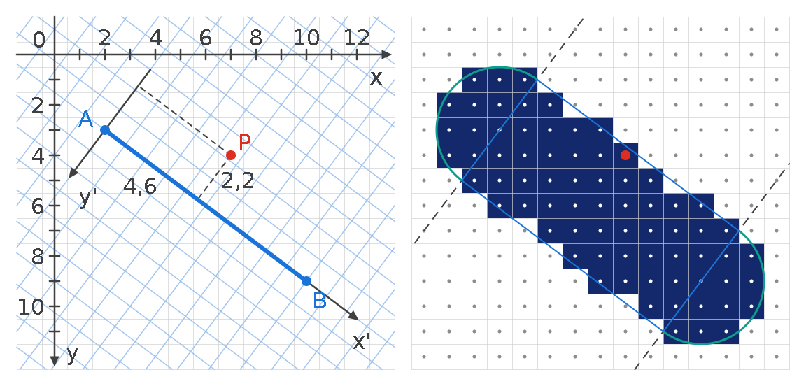

Как перенести систему координат — надо просто от координат точки отнять
координаты начала новой системы: `x − Ax` и `y − Ay`. Затем система
координат поворачивается на угол `θ`, под которым идёт отрезок; точка
относительно неё при этом поворачивается на `−θ`:

```
x' =  (x − Ax) · cos θ + (y − Ay) · sin θ
y' = −(x − Ax) · sin θ + (y − Ay) · cos θ
```

Из соотношений сторон прямоугольного треугольника `cos θ = (Bx − Ax) / L`,
`sin θ = (By − Ay) / L`, где `L` — длина отрезка. Тригонометрия здесь не
нужна: `cos θ` — на сколько отрезок сдвигается по `x` на каждый пиксель своей
длины, `sin θ` — на сколько по `y`. Оба числа считаются один раз на отрезок.

Пример с картинки: `A = (2, 3)`, `B = (10, 9)`. Отрезок идёт на 8 пикселей
вправо и на 6 вниз, его длина `L = 10`,
`cos θ = 0,8`, `sin θ = 0,6`. Голубая сетка на картинке — клетки новой
системы координат. Точка `P = (7, 4)` после переноса — `(5, 1)`, после
поворота:

```
x' =  5 · 0,8 + 1 · 0,6 =  4,6
y' = −5 · 0,6 + 1 · 0,8 = −2,2
```

Значит, `P` стоит напротив точки отрезка в 4,6 пикселя от `A` и в 2,2
пикселя от прямой `AB`; минус значит, что она по другую сторону прямой, чем
смотрит ось `y'`.

### Прямоугольник и полудиски

Линия пера вдоль отрезка — все точки, которые лежат от отрезка не дальше
`w / 2`. В координатах отрезка её легко описать; она нарисована на правой
половине картинки выше. Штриховые линии там — `x' = 0` и `x' = L`.

Если `0 ≤ x' ≤ L`, ближайшая к `P` точка отрезка лежит прямо напротив неё,
и расстояние до отрезка равно `|y'|`. Здесь линия — прямоугольник длиной `L`
и шириной `w`, и проверка, внутри ли точка, — два неравенства:

```
0 ≤ x' ≤ L
−w/2 ≤ y' ≤ w/2
```

Если `x' < 0`, ближайшая точка отрезка — его начало `A`. Точки линии там
лежат на расстоянии не больше `w / 2` от `A`, то есть образуют половину
диска с центром в `A`. Если `x' > L`, то же самое вокруг `B`. Прямоугольник и
два полудиска — вся линия, и концы у неё круглые сами собой.

Для `P` из примера `0 ≤ 4,6 ≤ 10` и `|−2,2| ≤ 2,5`: точка внутри линии пера
толщиной 5, и её пиксель закрашен.

Резкое перо закрашивает пиксель, если его центр внутри линии. Проверять так
каждый пиксель экрана по отдельности долго, поэтому перо идёт по строкам
пикселей. Для строки те же неравенства дают отрезок от левой границы до
правой, и всё между ними закрашивается сразу.

### Стыки

Кривая состоит из многих отрезков. Если рисовать у каждого только
прямоугольник, на повороте остаётся щель с внешней стороны (красный
треугольник на левой картинке). Её закрывают полудиски. На стыке два
полудиска — конца одного отрезка и начала следующего — лежат вокруг одной
точки, и целый диск накрывает оба. Поэтому перо рисует у каждого отрезка
прямоугольник и целый диск вокруг его конца, а у первого отрезка кривой ещё
диск в начале.

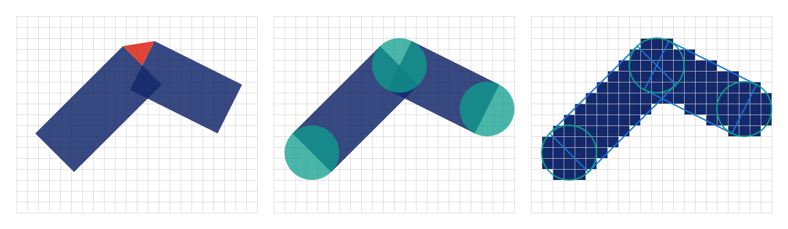

Сначала диски на стыках рисовались отдельно, и на них уходило от 33 до 48%
времени рисования буквы. Теперь прямоугольник и диск на его конце — одна
фигура, похожая на пулю. Каждая строка пикселей в ней — один сплошной
отрезок, и перо закрашивает её за один раз.

## Мягкий край

### Доля пикселя

Резкое перо закрашивает пиксель целиком или не трогает его. Мягкое
закрашивает пиксель настолько, насколько линия его накрывает: накрыла
половину — в пикселе половина чернил, накрыла четверть — четверть.

Лучше всего это видно в разрезе. Горизонтальная линия толщиной 2 идёт так,
что её середина на 0,3 пикселя ниже центра пикселя 4, на `y = 4,3`. Края
линии — на `y = 3,3` и `y = 5,3`. Пиксель 3 занимает по высоте от 2,5 до 3,5,
и линия накрывает 0,2 его высоты; пиксель 5 — от 4,5 до 5,5, накрыто 0,8.

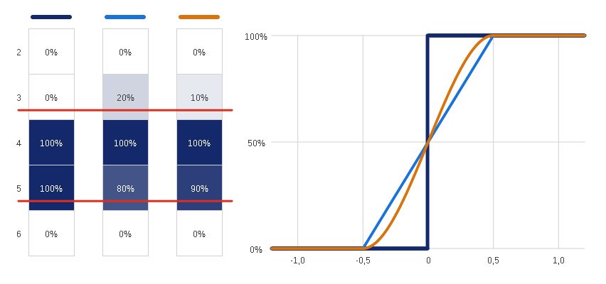

Слева пиксели 2–6 одного столбца экрана, красные линии — края линии; черта
над столбиком того же цвета, что его правило на графике. Первый столбик —
резкое перо, второй — мягкое, третий — smoothstep, о нём ниже. Справа те же
три правила графиком: по
горизонтали — насколько центр пикселя внутри линии, в пикселях (0 — на самом
краю, минус — снаружи), по вертикали — доля чернил.

Мягкое перо считает долю по расстоянию `d` от центра пикселя до отрезка:
`|y'|` напротив отрезка и расстояние до `A` или `B` за его концами.

```
доля = 0,5 + w/2 − d,  но не меньше 0 и не больше 1
```

Для пикселя 3 из разреза `d = 4,3 − 3 = 1,3`, и доля `0,5 + 1 − 1,3 = 0,2`;
для пикселя 5 `d = 0,7`, доля 0,8. На графике это синяя прямая:

- центр лежит на самом краю линии, `d = w/2`, — 50%;
- центр внутри линии на полпикселя или глубже — 100%;
- центр снаружи на полпикселя или дальше — 0%;
- в промежутке доля меняется по прямой.

Когда край идёт вдоль строк или столбцов пикселей, как в разрезе, это ровно
та часть площади пикселя, что лежит под линией. Когда край идёт наискось, —
почти она:

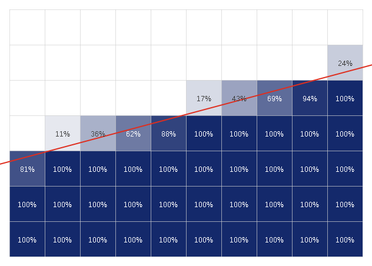

Красная прямая — верхний край толстой линии, в клетках — доля чернил, которую
мягкое перо дало пикселю.

`x'` и `y'` мягкое перо считает для каждого пикселя рядом с отрезком, и
умножать для этого не нужно. Из формулы поворота шаг на соседний пиксель
вправо прибавляет `cos θ` к `x'` и вычитает `sin θ` из `y'`, а шаг на строку
вниз прибавляет `sin θ` к `x'` и `cos θ` к `y'`.

С обычного расстояния отдельных пикселей не видно, глаз видит их среднюю
яркость. Наполовину закрашенный пиксель выглядит как край, проходящий через
его середину. Поэтому край мягкой линии виден там, где он должен быть,
точнее, чем на пиксель, и ступеньки почти не заметны: см. правую половину
увеличенного «Wein» выше.

### Четыре варианта

Мягкий край сначала был сделан в четырёх вариантах. Я их визуально сравнил
на названиях мест в полосе часов, пером толщиной 2:

1. **Резкое** перо, для сравнения.
2. **Фигура резкого** пера с мягким краем. Все точки целые, как у резкого
   пера, и у пера чётной толщины ось сдвинута на полпикселя вправо по ходу
   линии, тоже как у резкого. Этот вариант был сделан первым.
3. **Точки как есть**: концы отрезков ломаной не округлены, целые только концы
   самой кривой. Доля — по формуле выше.
4. **Smoothstep**: то же, но доля пропущена через `доля² × (3 − 2 × доля)`.
   Край становится круче в середине и плавнее у 0 и у 1 — оранжевая кривая
   на графике разреза.
5. **Всё дробное**: не округлены и опорные точки кривой.
6. **Мерило**: строка, нарисованная резким пером в 8 раз крупнее и
   уменьшенная усреднением каждого квадрата 8×8 пикселей. Так каждый пиксель
   получает почти точно ту часть своей площади, которую накрывает линия, но
   для полосы 320×46 нужен буфер почти в мегабайт.
7. **Сейчас**: нынешнее мягкое перо библиотеки, для сравнения.

Ниже три названия из того сравнения и одна фраза, вдвое крупнее, чем на
плате.

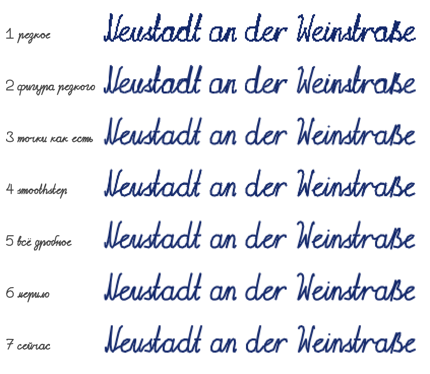

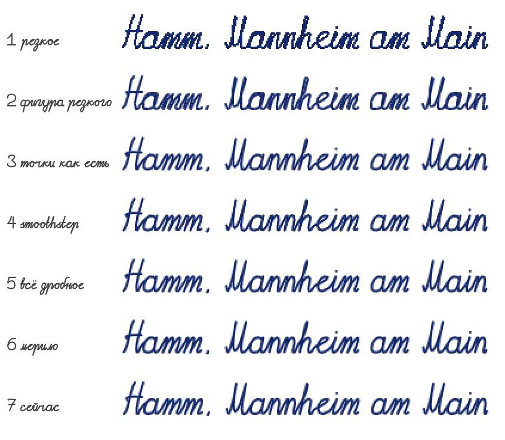

Буквы «amm» из той же строки под лупой:

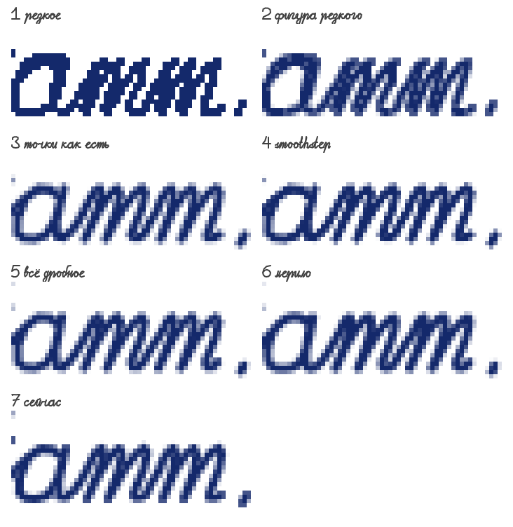

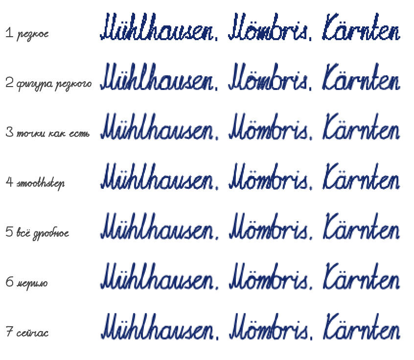

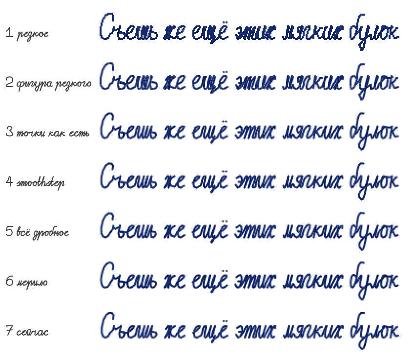

Варианты 2–5 библиотека больше не рисует. На картинках они посчитаны заново
по тем же правилам и с нынешним шрифтом.

Сколько чернил у каждой строки в каждом варианте; «пикселей чернил» — сумма
долей всех пикселей:

| Вариант | Neustadt… | Hamm… | Mühlhausen… | Съешь… |
| ------- | --------- | ----- | ----------- | ------ |
| 1       | 2387      | 2305  | 2565        | 2358   |
| 2       | 2286      | 2206  | 2456        | 2250   |
| 3       | 2070      | 2004  | 2244        | 2059   |
| 4       | 2071      | 2003  | 2247        | 2060   |
| 5       | 2068      | 1996  | 2224        | 2071   |
| 6       | 2113      | 2033  | 2279        | 2141   |
| 7       | 2069      | 1999  | 2240        | 2056   |

### Что выбрано

Любой мягкий вариант читается лучше резкого пера. Вариант 2 из них самый
тяжёлый: на 10% больше чернил, чем у остальных, и ножки «m» сливаются. Дело в
сдвиге оси. Резкое перо сдвигает ось чётной линии на полпикселя вправо по
ходу линии, и куда это «вправо», зависит от направления отрезка. У «m» перо
проходит первые две ножки дважды: вниз, а потом сразу вверх, к следующей
дуге. Вправо по ходу у этих двух проходов — в противоположные стороны. Оси
двух проходов расходятся на пиксель с лишним, и ножка толщиной 2 пикселя
становится толще 3.

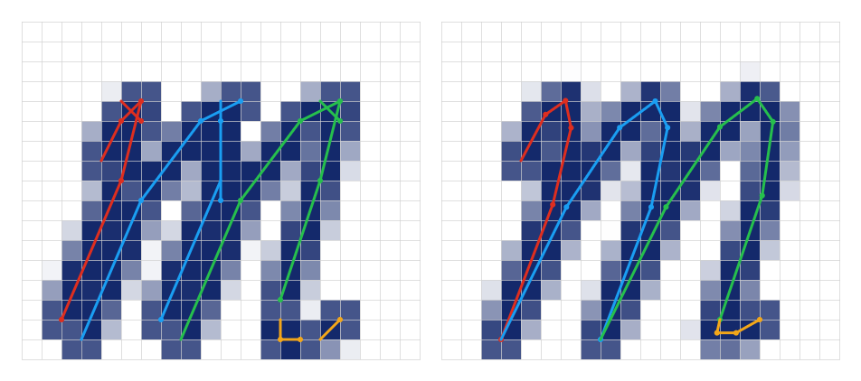

Буква «m» в размере часов под лупой. Линии — оси
отрезков, каждый штрих своим цветом. Слева вариант 2: красный штрих идёт по
первой ножке вниз, синий по ней же вверх, и их оси разошлись. Справа
нынешнее перо: оси двух проходов совпадают.

Та же фигура без сдвига набирает 2062 пикселя чернил на названии места, как
и варианты 3–5.

Целые точки делают линию неровной. Округление сдвигает каждый конец отрезка
до полпикселя в сторону, ломаная идёт вокруг кривой зигзагом, и линия
становится то толще, то тоньше, а на пологих местах ложится полками. Мягкому
перу целые точки не нужны: долю пикселя оно считает по расстоянию до
отрезка.

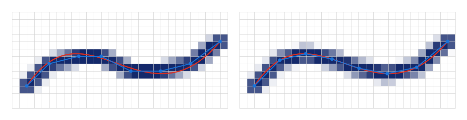

Кривая мягким пером толщиной 2. Слева концы отрезков округлены, справа
оставлены как есть; красная линия — кривая, синяя — ломаная. Левый вариант
библиотека не рисует: это те же отрезки, нарисованные мягким пером по одному
между округлёнными точками.

Варианты 3, 4 и 5 почти не различаются. Smoothstep меняет долю пикселя не
больше чем на десятую часть его чернил (график разреза): на пере в 2 пикселя
этого почти не видно, а на толстом пере, где край — малая часть линии, ещё
меньше. Дробные опорные точки
меняют чернила на доли процента, а функциям рисования понадобились бы другие
аргументы. Выбран вариант 3: у него самая читаемая «m».

После выбора в нём поменялись две вещи, и так получился вариант 7. Мягкая
линия чётной толщины сдвинута на полпикселя вправо и вниз, одинаково на всём
пути, см. [«Чётная толщина»](#чётная-толщина). И отрезок рисуется не пулей, а
полосой со срезанными концами, о ней в следующем разделе.

## Где куски встречаются

Фигуры у мягкого пера немного другие. Отрезок — полоса со срезанными
концами. На стыке с крутым поворотом между полосами встаёт кусок диска, а где
поворот мал, две полосы просто сходятся углом. Но и эти фигуры, как пули
резкого пера, ложатся друг на друга на стыках.

Резкому перу это всё равно: пиксель, закрашенный дважды, остаётся тем же.
Мягкому нет. Если бы доли складывались, полупрозрачный край на каждом стыке
получал бы чернила дважды, и на линии выросли бы узлы. Поэтому пиксель
оставляет себе большее из двух чисел: того, что в нём уже есть, и того, что
даёт перо. Стыки и пересечения от этого не темнеют, а линия, нарисованная
дважды, остаётся той же линией.

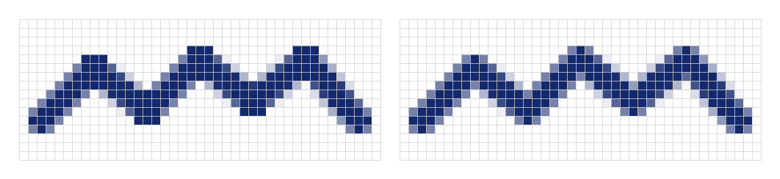

Ломаная из 6 отрезков пером толщиной 3, каждый отрезок нарисован отдельно,
со своими круглыми концами. Слева доли сложены, справа взята большая.

## Пиксель как количество чернил

Чтобы взять большее, перо должно прочитать, что в пикселе уже лежит, и это
должно быть количество чернил, а не цвет. Такой пиксель в DGX есть у
виртуального экрана с байтом на пиксель: это экран в памяти микроконтроллера,
каждый пиксель — число от 0 до 255. 0 — бумага, 255 — пиксель, накрытый
целиком, между ними — доли.

Цвет эти числа получают при отправке на дисплей: таблица переводит каждое
число в цвет между цветом бумаги и цветом чернил. Одни и те же байты можно
показать любой парой цветов. Над каждой строкой нарисована её таблица, от 0
слева до 255 справа:

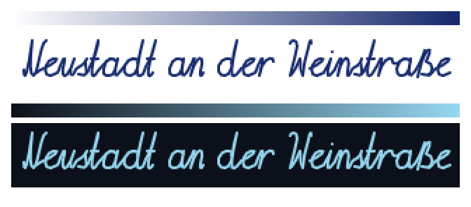

На других экранах мягкого пера нет. В 16-битном пикселе лежит цвет, а не
количество, а дисплей, к которому идут провода, библиотека прочитать не
может. Там перо, которое просили мягким, рисует как резкое той же толщины.

## Чётная толщина

У линии толщиной 3 есть средний пиксель, и точка кривой — его центр. У линии
толщиной 2 среднего пикселя нет. Точка мягкого пера толщиной 2 с центром в
пикселе накрывает его целиком и четыре соседних наполовину: выходит
крестик. Точка над «i» так и выглядела, а две точки над «ö» касались друг
друга.

Поэтому мягкая линия чётной толщины сдвинута на полпикселя вправо и вниз.
Целая точка попадает на угол между четырьмя пикселями, и точка пера
толщиной 2 становится квадратом 2×2, по 79% чернил в каждом пикселе. Резкое
перо ставит свою точку туда же. Сдвиг один на всю линию, куда бы она ни шла,
поэтому оси проходов туда и обратно не расходятся, как в варианте 2.

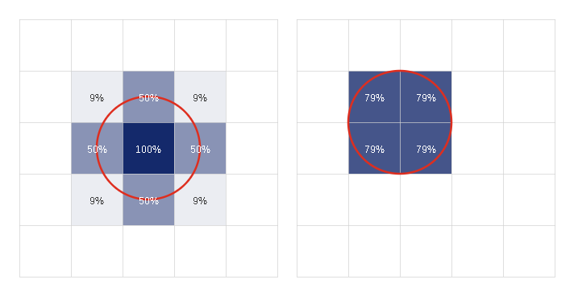

Красный круг — точка пера диаметром 2 пикселя. Слева её центр в пикселе:
так библиотека не рисует, доли посчитаны по тому же правилу. Справа центр на
углу четырёх пикселей, как рисует библиотека.

## Стирание

Перо с цветом 0 стирает. У мягкого пера с цветом 0 правило своё: каждый
пиксель, которому линия дала бы хоть сколько-то чернил, становится нулём.
Мягкое перо, прошедшее тем же путём, снимает мягкую линию целиком.

Резкое перо с цветом 0 снимает только пиксели резкой линии. От мягкой
остаются края, а местами и целые пиксели: у резкой линии точки целые, а ось
чётного пера сдвинута по-своему, и лежит она не точно там же, где мягкая.

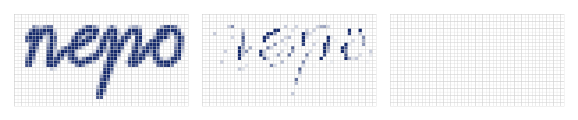

Слева слово «перо» мягким пером толщиной 2. В середине оно же после резкого
пера с цветом 0 тем же путём, справа после мягкого.

## Что быстрее

Я ожидал, что мягкое перо будет медленнее: ему надо посчитать долю каждого
пикселя. Вышло иначе, потому что перья тратят время на разное. Резкое
платит за строку фигуры: около микросекунды на строку, сколько бы пикселей в
ней ни было. Мягкое платит за пиксель: внутри длинного отрезка пиксель стоит
26 наносекунд, а на краю диска вчетверо больше, там нужен квадратный корень.
В мелком тексте строки короткие, а у мягкого пера почти все пиксели на
краях, и быстрее резкое. В крупном строки длинные, пиксели мягкого пера в
основном внутри полос, и быстрее мягкое.

Время рисования на CYD (ESP32, 240 МГц) в 8-битный экран в памяти, без
отправки на дисплей, в миллисекундах; замер версии 0.10.15, код шрифта и
пера в IRAM (`CONFIG_DGX_HW_FONT_IN_IRAM` и `CONFIG_DGX_BEZIER_IN_IRAM`).
Строка шрифта при масштабе 0,25 высотой около 50 пикселей, при масштабе 1 —
202 пикселя.

| Что                                         | Резкое | Мягкое |
| ------------------------------------------- | ------ | ------ |
| Название места, перо 2                      | 3,56   | 3,82   |
| «The quick brown fox», масштаб 0,25, перо 3 | 3,02   | 3,38   |
| Оно же, масштаб 1, перо 9                   | 7,77   | 4,55   |

Первая версия мягкого пера рисовала название места почти вдвое дольше
резкого, 14,7 мс против 8,5. Дело оказалось в основном не в пере, а в том,
как его код и таблицы шрифта легли в кэш flash; как это найдено и
исправлено, написано в [pen-ru.md](../../dgx/pen-ru.md#кэш-flash).

По умолчанию этот код лежит во flash и читается через кэш, и тогда время
зависит ещё и от того, как код и таблицы шрифта легли в кэш в данной сборке.
Те же строки из flash в версиях 0.10.13–0.10.15: название места 4,25–4,83 мс
резким пером и 4,48–5,49 мягким, мелкий текст 3,49–3,78 и 3,84–4,43, крупный
8,41–8,78 и 5,03–5,61. Какое перо где быстрее, от этого не меняется.

## В коде

Вид пера выбирается при каждом рисовании вместе с толщиной: `DGX_PEN_SOFT | 2`
— мягкое перо толщиной 2, просто `2` — резкое. Мягкому перу нужен экран с
байтом на пиксель, а цвет — это количество чернил, от 0 до 255.

```c
dgx_screen_t *band = dgx_vscreen_init(320, 46, 8, DgxScreenRGB);
dgx_hw_draw_text(band, x, y, font0ss(), "Neustadt an der Weinstraße", scale, DGX_PEN_SOFT | 2, 255, true);
dgx_vscreen8_to_screen16(lcd, 0, 0, band, lut, 0);
```

`lut` — таблица из 256 цветов от бумаги до чернил.

Резкое перо в библиотеке осталось. Ему не нужно читать уже нарисованные
пиксели, поэтому оно рисует прямо на дисплее, без экрана в памяти. Им можно
пользоваться, когда памяти на виртуальный экран не хватает.

## Результат использования

Мягкие края кривых смотрятся заметно приятнее, чем резкие. Особенно на маленьких
экранах. Они как будто добавляют разрешение. Но даже на более крупных,
вроде 7" 1024×600 или даже 10" 1280×800, разница всё равно заметна. В результате
в DGX было внедрено не только мягкое перо для рисования кривых, но и отдельно толстые отрезки
с мягкими краями, мягкий край у закрашенного круга и мягкие края у шрифтов.
