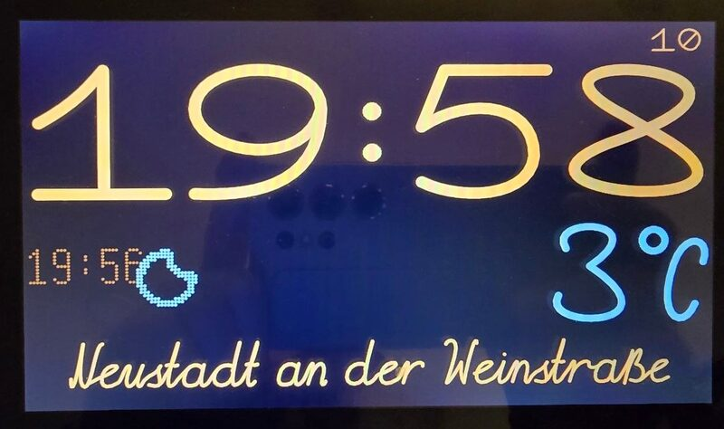
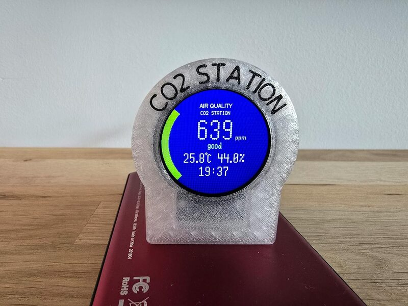

# Anton Petrusevich

Components and programs for ESP32 microcontrollers with displays, built on
ESP-IDF. DGX drives SPI, QSPI, I2C, 8-bit parallel and MIPI-DSI panels, from
0.96-inch OLEDs and e-paper to the 10.1-inch display of an ESP32-P4, and draws
on them with anti-aliased fonts, alpha blending, crossfades, a translucent
overlay layer, handwritten text written stroke by stroke, and dot morphing.
DGX-LVGL runs LVGL on the same displays, DGX-DI adds touch input, and boards
describes a board once, as data.

-   **[Handwritten clock](handwritten-clock/index.md)**

    

    A weather clock on an ESP32: the time, the temperature and the place
    name written by a pen in a font of Bézier curves.

-   **[DGX](dgx/index.md)**

    

    The display library under all of it. Here it writes with a pen, stroke
    by stroke, in a font of Bézier curves.

-   **[Dot morphing](articles/matrix-font-en/index.md)**

    <video src="home/dot-morph.mp4" autoplay loop muted playsinline></video>

    Digits and weather symbols that flow dot by dot from one into another.

-   **[Morphing in the Game of Life](articles/life-morphing-en/index.md)**

    <video src="home/life-morph.mp4" autoplay loop muted playsinline></video>

    Cells that are born and die smoothly instead of switching on and off.

-   **[CO2 station](articles/co2-station-en/index.md)**

    

    An ESP32-C3, an SCD41 sensor and a round GC9A01 display, reporting to
    Home Assistant over MQTT.

## What is here

| Part | What is in it |
| --- | --- |
| [ESP32 Components](components/index.md) | Components for ESP-IDF programs: DGX for displays and graphics, touch input, LVGL on DGX displays, a game engine, boards described as data, an NFC reader |
| [Projects](projects/index.md) | Programs built on the components: the handwritten clock |
| [Articles](articles/index.md) | Articles on the components and projects, first published on Habr, Hackster and Hackaday.io |
| [Misc](misc/index.md) | Everything else: FIT Visualizer, an extension of VS Code for workouts |
