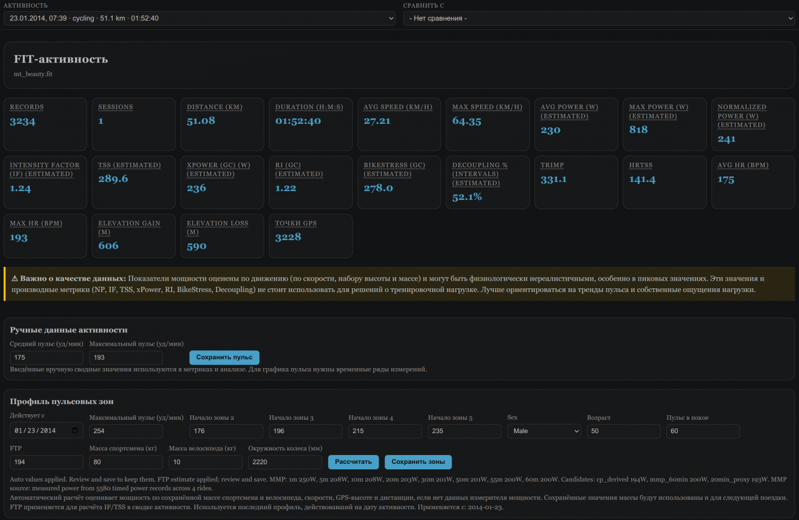
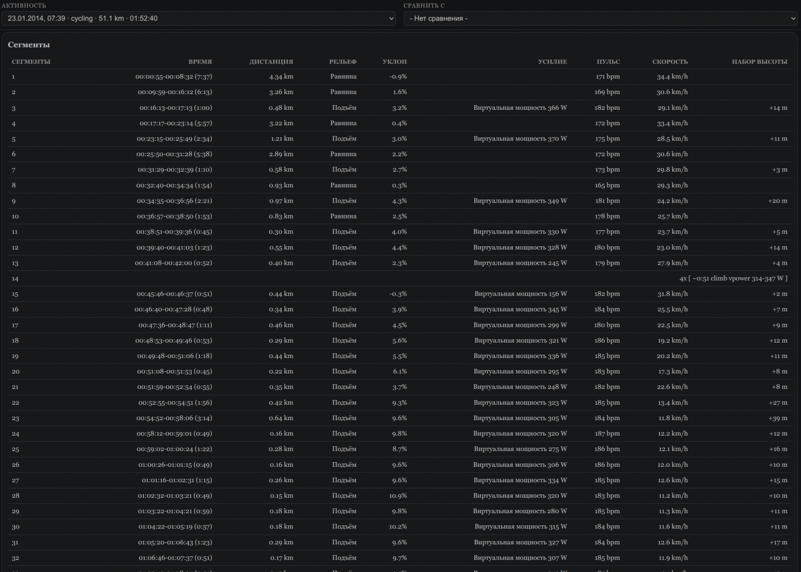
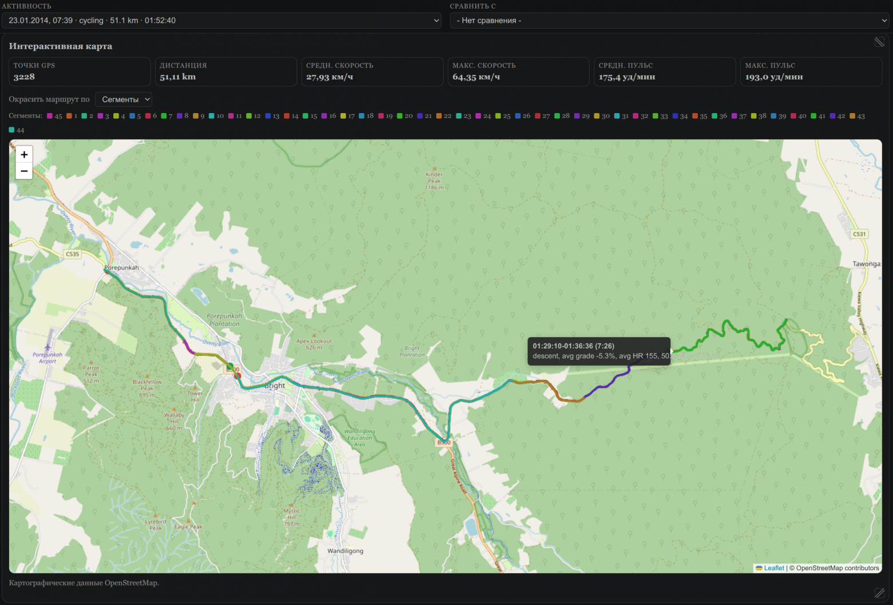
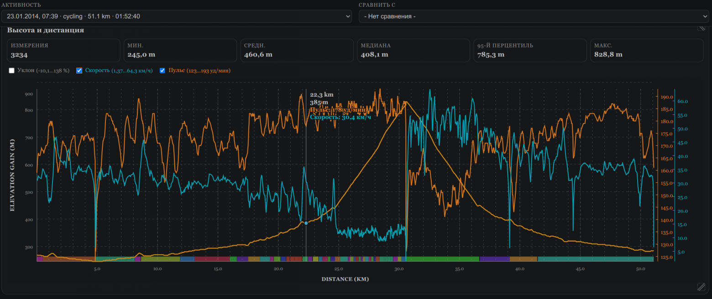
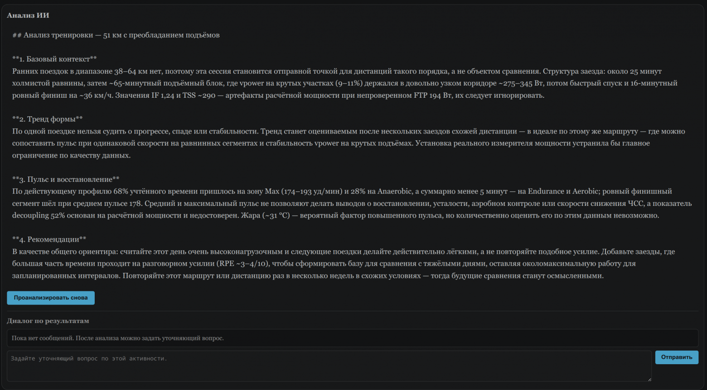

# FIT Visualizer: From a Google AI Mistake to My Own Workout Analyzer

*Translated from the Russian original, first published on [Habr](https://habr.com/ru/articles/1083882/).*

It all started with choosing a bike computer.

I was comparing a few inexpensive models, among them a Sigma ROX 4.0 at about 80 euros and a CYCPLUS M1 at about 50. Feature for feature they looked fairly similar, so I decided to ask Google AI for advice.

Among other things, Google AI told me that the Sigma ROX 4.0 would show its main strengths on my e-bike, while the CYCPLUS M1 could be connected to a computer over USB as Mass Storage, so the workout files could be copied off it for later analysis. I don't have an e-bike, so I chose the CYCPLUS M1.

For working with FIT files on Linux, Google AI recommended GoldenCheetah as hands down the best option, calling it a world-class professional tool for workout analysis, free and open source.

That was a fairly convincing argument.

Later, when I asked Google AI specifically about Linux and USB-C, it said the opposite: the USB port is for power only, and data transfer needs Bluetooth LE. It also suggested a project called CycSync, a Python script on GitHub.

The script read the files from my CYCPLUS M1 without trouble, but having to write the device name into it by hand was inconvenient. Every unit of this model has a name of its own, which contains part of the MAC address. So I reworked the script a little to make it pick the first M1 it finds automatically.

At the time I was planning to use this script inside a VS Code extension I was about to write, so that the extension could fetch FIT files from the bike computer by itself. That is why the change made practical sense.

Later I dropped the idea of such an all-in-one tool: getting data off the device and analyzing it turned out to be rather different tasks. The extension ended up working with the FIT files themselves, hence the name FIT Visualizer.

## Where FIT Files Come From

One important point here, by the way: FIT is not a CYCPLUS format.

FIT (Flexible and Interoperable Data Transfer) is a binary format for recording sports activity data. Garmin developed it originally, but today it is used far beyond Garmin's ecosystem.

Garmin, Wahoo, Polar, Suunto, COROS, Bryton, Hammerhead and Sigma, among others, use or export FIT. Training services use it too, Zwift for one. And if you log your workouts in Strava, you can download the original activity file from there as well; in many cases it will be a FIT file. Strava also accepts FIT files for manual upload.

So if you already have FIT files from a watch, a bike computer or a training service, they should in principle work with FIT Visualizer. In this story the CYCPLUS was only the first source of data.

In my case, getting the original FIT files off the M1 turned out to be a bit harder, so I had to find a way to pull them over Bluetooth.

These files are where the actual development of FIT Visualizer began.

## How It Works in Practice

These days a typical session goes roughly like this.

After a workout I have a FIT file. I open it in VS Code, and FIT Visualizer parses the activity, draws the charts and the map, and computes derived metrics. The new workout doesn't stand on its own: it can be compared with similar activities from the history.

Then I can run the AI analysis. The model doesn't get the FIT file as it is; it gets a prepared context with the analysis results and historical data. It can spot a trend that isn't obvious from the individual charts, point out questionable numbers and come up with recommendations.

And then comes what is probably the most interesting part: the result can be discussed with the model. You can clarify the circumstances of the workout, correct a mistake in the original context, add data that wasn't in the FIT file, and ask why the model drew a particular conclusion.

So instead of the usual routine of "open the workout → look at a few charts → close it", you can not only look at the data but also ask questions about the training history you have built up.

Below is how I got here in the first place.

## What to Do with FIT Files

On Linux I found a few programs that could potentially help. Google AI suggested some of them.

The first was GPXSee. It can display GPS tracks, but I ran into a rather practical problem with the map: OpenStreetMap wouldn't serve tiles because its User-Agent was blocked at the time. The problem was described in the Issues, with a fix promised in the next release, but I wasn't interested in waiting several more weeks.

The second option was GoldenCheetah. This one is an actual workout analysis program, so it looked promising.

But GoldenCheetah crashed whenever I tried to open my FIT files.

Maybe my CYCPLUS writes broken FIT files? I decided to try converting them with GPSBabel. If it could read them and write them out again in another format, the problem might go away.

That didn't help GoldenCheetah either. It stubbornly crashed every time it tried to read the files.

Well, I'm a programmer! I decided it would be easier to write my own.

## What I Actually Wanted

That said, I didn't need just a FIT viewer.

I had the idea of using an LLM to analyze workouts from the very start. And what I was after was the historical perspective.

A single workout on its own doesn't always tell you much. It is much more interesting to set it against what came before: similar workouts, recent load, previous results. And, more generally, to see trends and progress over at least a month.

The database came about precisely because of this idea.

If you just open FIT files one at a time, you get no proper history. The parsed activities had to be stored somewhere, so that I could later search for similar ones, compare metrics and use the accumulated data when analyzing a new workout.

That is how FIT Visualizer gradually became not only a FIT viewer but also a local database of training history. The data is indexed into SQLite inside the working folder, while the original FIT files stay where they were.

## Why VS Code

I chose VS Code as the host. It has everything I needed: it can open a local file, show my own UI in a webview, draw charts and a map, and keep the data local.

The Marketplace mattered a lot too. Personally, I always get a little nervous when I have to download a binary from some website and run it on my computer: what if there's a virus in it? Is this really the genuine site? With a VS Code extension this problem doesn't exist in its usual form: the extension is installed from the Marketplace, isn't tied to a particular operating system, and runs on Linux, Windows and macOS.

On top of that, VS Code can work with language models through Copilot.

I also localized the interface. FIT Visualizer tries to use the same language as VS Code itself. And it isn't only the names of buttons and sections that get translated, but also the analysis terms together with their hover explanations.

If there is no packaged localization for the language you need yet, the extension can offer to generate one automatically with a model. That way support for a new language can be added without translating every string by hand.

By default the AI analysis is also in the interface language. After that, though, the model usually adapts to the user's own language: if you carry on the conversation in another language, the answers as a rule switch to it. So you can, for example, keep the interface in English and discuss your workout results in Russian.

So the sports analyzer ended up as an extension for a code editor. Perhaps not the most obvious choice, but it seemed convenient to me.

AI is not a required part of the program. Viewing FIT files, indexing, charts, the map, segmentation, comparing two activities, heart-rate zones and everything else work without GitHub Copilot. But for me personally it was one of the main points of the project.

## Cycling and Running

Right now I use FIT Visualizer mainly for cycling workouts. I develop and test all the main features on them.

Still, neither the FIT format itself nor most of the analysis is tied to cycling. FIT is used for other kinds of workouts too, running for example, so FIT Visualizer works with more than just rides. What differs is mainly the metrics available and how some of the derived metrics are calculated.

In the rest of the article I'll mostly show cycling examples, simply because that is my real data.

**Automatic wheel-circumference calibration**

For cycling there is one more small but useful feature: automatic wheel-circumference calibration.

If the bike has a wheel speed sensor, the distance it measures depends on the wheel circumference set in the bike computer. FIT Visualizer can compare that distance with GPS on long enough straight stretches with a good track and estimate whether a correction is needed.

The extension doesn't try to calibrate the wheel from questionable data, though: if there are no suitable stretches or it isn't confident enough, it simply suggests nothing.

## Averages Weren't Enough

Before that I mostly used Samsung Health. It shows quite a lot of workout data: speed, heart rate, altitude and other parameters. But comparing workouts there is awkward: you can't simply lay the chart of one workout over the chart of another.

Besides, the data within a workout is split into laps or kilometer splits. That isn't always a good basis for comparison either. Even on the same route the boundaries of the stretches can differ depending on what happened on a particular ride. For example, you may cross the same road without stopping one day and be held up by traffic the next time.

That is why FIT Visualizer got its own automatic segmentation.

It splits a workout into stretches for analysis, guided by the nature of the load and changes in riding conditions. It takes into account altitude, speed, stops and effort. In long enough stretches it also considers how the effort changes within the stretch itself.

A segment here is specifically a unit of analysis. It is not a lap and not a kilometer split.

For example, on the same stretch of road I may stop at a traffic light on one ride and go straight through on another. In the first case the stop splits the stretch in two; in the second it stays a single segment.

So when two activities are compared, such segments have to be matched by their order and characteristics, even if the boundaries of the stretches don't line up between the two rides.

## How to Measure Effort

FIT Visualizer can work with power data if the FIT file has it. In that case it uses the measured values directly and computes the derived metrics from them.

I have never had a power meter, so I haven't been able to test this part on real data yet. For workouts without a power meter, FIT Visualizer can estimate effort from the other data available.

For cycling it uses a physical model that estimates power from speed, grade and the parameters of the rider and the bike. It accounts for gravity, rolling resistance, aerodynamic drag and the work of accelerating. Wind is not modeled.

On a climb gravity's contribution is fairly large, so such an estimate can be useful. On the flat, and especially on descents, aerodynamics and wind matter much more, so effort there is estimated from heart rate. For stretches where the speed data itself is unreliable, such as some technical descents, no effort estimate is given at all.

This matters for the AI analysis too. The model receives not only the value itself but also information on how reliable each metric is: which data can be trusted more and which should be treated with caution. So if a number comes from a model with significant limitations, the AI must not treat it as if a real sensor had measured it to the nearest watt.

## What the Database Holds

SQLite came in fairly early, because from the very beginning the project needed somewhere to store parsed activities and analysis results.

The database holds the activities themselves and their FIT records, the computed results, heart-rate zone profiles and the data needed to compare workouts. Later the AI analysis results and the history of AI comparisons were added.

This means the analysis isn't limited to the activity currently open. It can draw on the accumulated history, for example by taking into account similar workouts, recent load and the results of earlier AI analyses.

The pipeline looks roughly like this:

**FIT → local database → analysis → historical context → LLM**

The database isn't there only to store AI results, though. Much of the analysis and workout comparison existed before AI analysis appeared.

## Comparing Two Workouts

Comparing two specific activities lets you set their metrics side by side and see their charts laid over each other. The comparison runs locally on data from the database.

The next step was to use this data for AI analysis. You can pick another workout and ask the AI to compare it with the current one. The comparison covers not only the overall figures but also individual segments.

Here you can't just say: compare segment 1 with segment 1.

As mentioned above, a stop can split a stretch in one workout while the same stretch stays whole in another. So segments have to be matched by their order and characteristics, not just by number.

AI comparison results are saved. Comparing A with B and B with A are stored separately: the direction of the comparison matters here.

## What the LLM Receives

The language model itself does not parse the FIT file.

First, ordinary code parses the data, computes the metrics, builds the segments and picks the relevant parts of the history. Only after that does it put together the context for the analysis.

The context may include the data of the current workout, its segments, comparable earlier activities, recent load, personal bests and earlier AI analyses.

The original FIT file is not sent to the model. FIT Visualizer builds a separate analysis context from the activity data and derived results. This context is sent only when AI analysis is turned on, and it goes through GitHub Copilot according to the Copilot settings.

The application itself stays local: the database lives in `.fit-visualizer/fit-data.sqlite`, and it does not upload or copy the original FIT files to any remote service.

For me this was an essential requirement of the project. A FIT file can contain not only sports metrics but also quite sensitive data: coordinates, times, training history.

## The Visual Side

Meanwhile the ordinary part of the interface kept growing.

In the editor you can now see the activity summary, speed, heart-rate and altitude charts, the GPS track on a map, heart-rate zones and segment details.

The GPS track can be colored by speed, heart rate or detected segments. The same segments show up on the charts as well, so a stretch on the map and the matching part of a chart are linked.

The visual side is not a goal of the project in itself, though. It is there mostly so that you can look at the same data that the analysis then uses.

## AI Analysis

AI analysis in FIT Visualizer is not just one more screen of auto-generated text. The model receives the results of the local analysis and the historical context, and then gives its own interpretation of the ride.

It can point out notable trends, compare the current activity with similar rides, flag unusual numbers and make recommendations for the future. The context also carries information on how reliable each metric is, so the model knows which data it can trust more and which it should treat with more caution.

For example, one analysis went roughly like this: a speed of 23.35 km/h against an average of 22.7 km/h for comparable rides, and an average heart rate of 133 against 138. The model noted this as a possible sign of improved efficiency and related the result to earlier rides and to the rest before the workout. At the same time it ignored the questionable estimated-power figures, because it had received a warning about the quality of that data.

And the result of the analysis can be discussed with the model.

In one such conversation I pointed out that the phrase "first ride after three days of rest" wasn't quite right: I had indeed rested for two days, but on 22 August there was another ride; I had simply left the bike computer at home that day. The model revised its conclusion with this in mind, and then I added the data for that ride: its duration, average speed and heart rate.

After that, even more details came out. The 22 August route turned out to be different in character, the altitude data was clearly corrupted, and heavy rain had started before the last stretch. The model no longer tried to compare this data mechanically with today's ride; it took the limitations of that particular recording into account instead.

The conversation can go on from there. For example, I asked why the recommendations suggested not going back to daily hard workouts. When I asked whether my body really wasn't adapting to the load, the model now explained its recommendation in terms of the accumulated data from earlier rides.

This kind of conversation is what I now consider the main value of the project. Ordinary analytics shows numbers and charts; here you can ask questions about the data already collected, add context, correct mistakes and figure out, together with the model, what happened in a particular workout.

The conversation history is stored locally and tied to a specific analysis, so you can come back to it later and pick up where you left off.

## Where It Ended Up

Looking back at the original task, FIT Visualizer as it is now has moved quite far from it.

It all began with a quite practical wish: to get the FIT files off an inexpensive bike computer and see what was actually in them.

The existing programs couldn't cope with my files, so I made a viewer of my own. And since I wanted not just to look at individual rides but to compare them with one another, a local database, analysis, segmentation and a search for comparable activities gradually followed.

The original idea of using an LLM for historical analysis never went away. On the contrary, as the data piled up, there was more and more context for it. As a result, the AI here doesn't replace ordinary analysis but works on top of it: it gets data that has already been prepared, sees the training history and can come up with observations and recommendations, and then you can discuss those conclusions with the model and add to the context.

This is what I now consider the main value of the project. Charts, metrics and comparing two workouts can all be done perfectly well without AI. It gets more interesting when the accumulated history becomes the context for a conversation about your own training.

At the same time, FIT Visualizer remains a fairly local and, in a sense, selfish tool. It doesn't try to replace Strava, Garmin Connect or a full-fledged sports analytics platform. I just wanted to work properly with my own data and see what happens if the accumulated history goes to an LLM not wholesale but after processing and analysis of my own.

And it all started with Google AI telling me about USB Mass Storage on the CYCPLUS M1.

I have to give it credit: if it hadn't been wrong back then, this project might not exist at all.

## Installing in VS Code

Press Ctrl+P in VS Code to open Quick Open, paste the command

`ext install AntonPetrusevich.fit-visualizer`

and press Enter.

## Links

- [VS Code Marketplace](https://marketplace.visualstudio.com/items?itemName=AntonPetrusevich.fit-visualizer)
- [GitHub](https://github.com/jef-sure/fit-visualizer)
