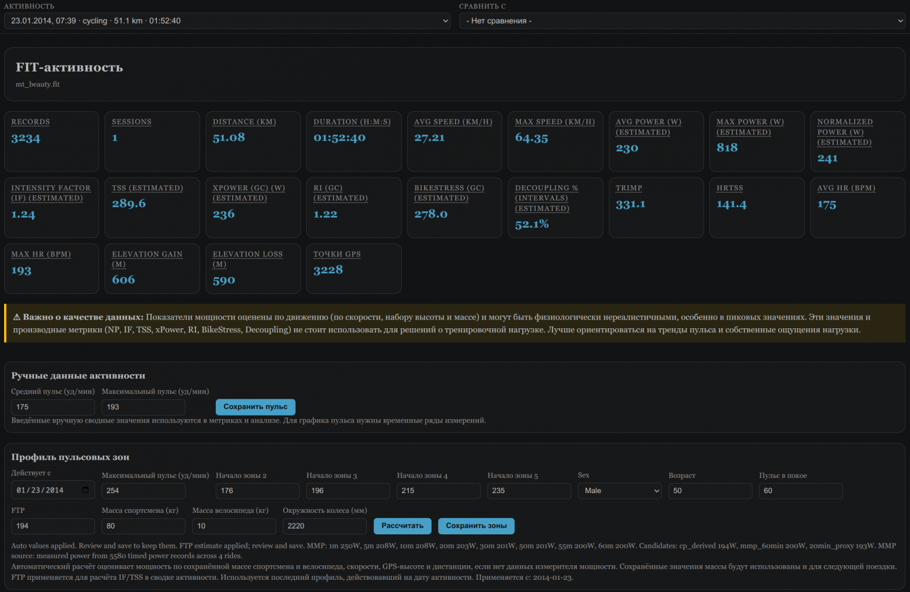
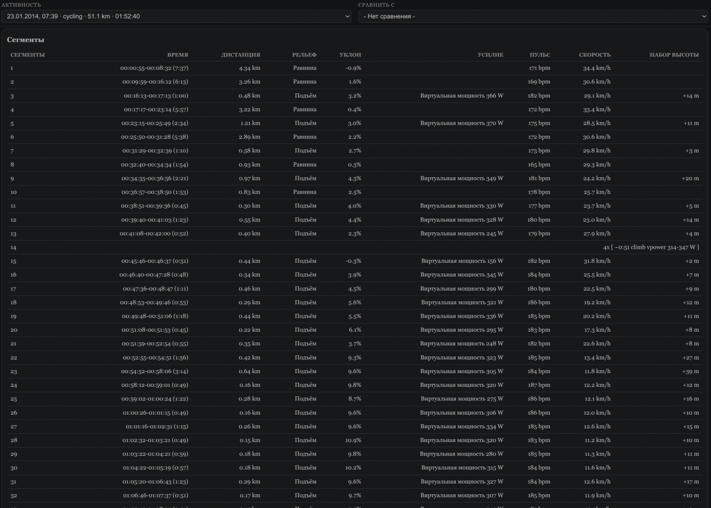
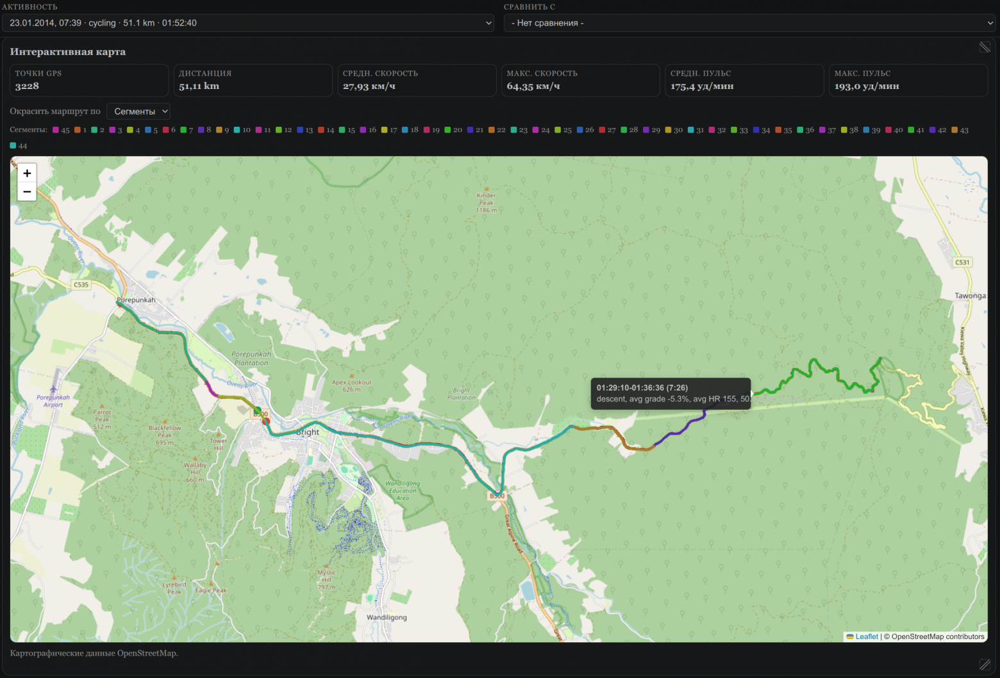
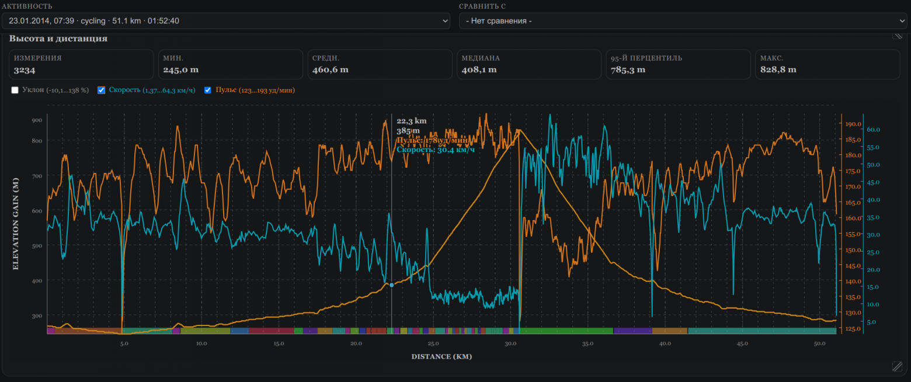
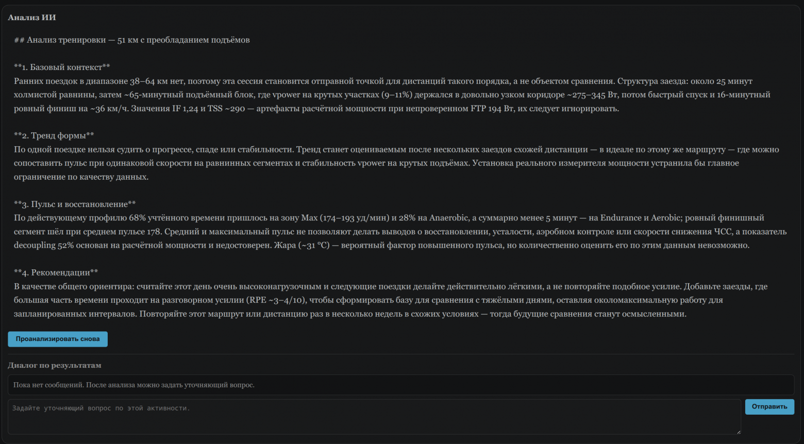

# FIT Visualizer: как я дошёл от ошибки Google AI до собственного анализатора тренировок

*Впервые опубликовано на [Хабре](https://habr.com/ru/articles/1083882/).*

Всё началось с выбора велокомпьютера.

Я сравнивал несколько недорогих вариантов — в частности, Sigma ROX 4.0 примерно за 80 евро и CYCPLUS M1 примерно за 50. По возможностям они выглядели достаточно похоже, поэтому я решил спросить совета у Google AI.

Google AI, среди прочего, сообщил мне, что основные преимущества Sigma ROX 4.0 раскроются на моём электровелосипеде, а CYCPLUS M1 можно подключить к компьютеру по USB как Mass Storage и забрать с него файлы тренировок для дальнейшего анализа. Электровелосипеда у меня нет, поэтому был выбран CYCPLUS M1.

Google AI рекомендовал GoldenCheetah как безусловно лучший вариант для работы с FIT-файлами под Linux, называя его профессиональным инструментом мирового уровня для анализа тренировок — бесплатным и с открытым исходным кодом.

Это было довольно убедительным аргументом.

Позже, когда я специально спросил Google AI про Linux и USB-C, он написал обратное: USB-порт используется только для питания, а для передачи данных нужен Bluetooth LE. При этом предложил мне воспользоваться проектом CycSync — Python-скриптом на GitHub.

Скрипт успешно читал файлы с моего CYCPLUS M1, но было неудобно вручную прописывать в нём имя устройства. У каждого устройства этой модели оно уникальное и содержит часть MAC-адреса. Поэтому я немного доработал скрипт, чтобы он автоматически находил первый обнаруженный M1.

На тот момент я как раз планировал использовать этот скрипт внутри будущего расширения для VS Code, чтобы расширение само могло получать FIT-файлы с велокомпьютера. Поэтому такая доработка имела вполне практический смысл.

Впоследствии от идеи такого комбайна я отказался: получение данных с устройства и их анализ оказались достаточно разными задачами. В результате расширение занялось непосредственно FIT-файлами, откуда и появилось название FIT Visualizer.

## Откуда взялись FIT-файлы

Здесь, кстати, есть важный момент: FIT — это не формат CYCPLUS.

FIT (Flexible and Interoperable Data Transfer) — бинарный формат для записи данных спортивных активностей. Изначально его разработал Garmin, но сейчас он используется далеко за пределами его экосистемы.

FIT используют или экспортируют, в частности, Garmin, Wahoo, Polar, Suunto, COROS, Bryton, Hammerhead и Sigma. Формат используется и тренировочными сервисами — например, Zwift. А если вы ведёте тренировки в Strava, оттуда тоже можно скачать оригинальный файл активности: во многих случаях это будет FIT. Strava также принимает FIT-файлы при ручной загрузке.

Поэтому если у вас уже есть FIT-файлы от часов, велокомпьютера или тренировочного сервиса, они потенциально подходят для FIT Visualizer. CYCPLUS в этой истории оказался только первым источником данных.

В моём случае получить исходные FIT с M1 оказалось немного сложнее, поэтому пришлось искать способ забрать их по Bluetooth.

Именно с этих файлов и началась уже собственно разработка FIT Visualizer.

## Как это выглядит в работе

Типичный сценарий сейчас выглядит примерно так.

После тренировки у меня появляется FIT-файл. Я открываю его в VS Code, и FIT Visualizer разбирает активность, строит графики, карту и рассчитывает производные показатели. Новая тренировка при этом не существует сама по себе: её можно сопоставить с похожими активностями из истории.

После этого можно запустить AI-анализ. Модель получает не исходный FIT-файл как есть, а подготовленный контекст с результатами аналитики и историческими данными. Она может заметить тренд, который не так очевиден по отдельным графикам, обратить внимание на сомнительные показатели и сформулировать рекомендации.

А дальше начинается, пожалуй, самое интересное: результат можно обсуждать с моделью. Можно уточнить обстоятельства тренировки, исправить ошибку в исходном контексте, добавить данные, которых не было в FIT, и спросить, почему был сделан тот или иной вывод.

То есть вместо привычного сценария «открыл тренировку → посмотрел несколько графиков → закрыл» получается возможность не только посмотреть на данные, но и задавать вопросы по уже накопленной истории тренировок.

Дальше расскажу, как я вообще до этого дошёл.

## Что делать с FIT

На Linux я нашёл несколько программ, которые потенциально могли помочь. Часть из них была подсказана Google AI.

Первой была GPXSee. Она умеет показывать GPS-треки, но с картой у меня возникла довольно практическая проблема: OpenStreetMap не отдавал тайлы из-за заблокированного в тот момент User-Agent. Проблема была описана в Issues, там обещалось исправление в следующем релизе, но ждать ещё несколько недель было неинтересно.

Вторым вариантом был GoldenCheetah. Это уже непосредственно программа для анализа тренировок, поэтому выглядело многообещающе.

Но при попытке открыть мои FIT-файлы GoldenCheetah падал.

Может быть, мой CYCPLUS делает кривые FIT-файлы? Решил попробовать их сконвертировать с помощью GPSBabel. Если он сможет их прочитать и записать заново в другом формате, возможно, проблема исчезнет.

Но GoldenCheetah и это не помогло. Он упорно падал при попытке чтения файлов.

Ну я ж программист! Решил, что проще написать свою.

## Что я вообще хотел получить

При этом мне нужен был не просто просмотрщик FIT.

Идея использовать LLM для анализа тренировок у меня была изначально. Причём интересовал именно исторический разрез.

Одна отдельная тренировка сама по себе не всегда особенно много говорит. Гораздо интереснее сопоставить её с тем, что уже было: с похожими тренировками, с недавней нагрузкой, с предыдущими результатами. И вообще увидеть тренды и прогресс хотя бы за месяц.

Поэтому база данных появилась именно из-за этой идеи.

Если просто открывать FIT-файлы по одному, то никакой нормальной истории не получится. Нужно было где-то хранить уже разобранные активности, чтобы потом можно было искать похожие, сравнивать показатели и использовать накопленные данные при анализе новой тренировки.

Так FIT Visualizer постепенно стал не только просмотрщиком FIT, но и локальной базой истории тренировок. Данные индексируются в SQLite внутри рабочего пространства, а исходные FIT-файлы при этом остаются там, где они были.

## Почему именно VS Code

В качестве оболочки я выбрал VS Code. В нём можно сделать всё необходимое: открыть локальный файл, показать собственный интерфейс через webview, нарисовать графики и карту, а данные хранить локально.

Немаловажным было и существование Marketplace. Лично я всегда немного нервничаю, когда приходится скачивать бинарную программу с какого-то сайта и запускать её у себя на компьютере: а что если там вирус? А точно ли это настоящий сайт? В случае с расширением VS Code такой проблемы в привычном виде нет: расширение устанавливается через Marketplace, не привязано к конкретной операционной системе и работает на Linux, Windows и macOS.

Кроме того, у VS Code есть возможность работать с языковыми моделями через Copilot.

Также я сделал локализацию интерфейса. FIT Visualizer пытается использовать тот же язык, что и среда VS Code. Причём локализуются не только названия кнопок и разделов, но и термины аналитики вместе с подсказками к ним.

Если для нужного языка готовой локализации ещё нет, расширение может предложить сгенерировать её автоматически с помощью модели. Таким образом, добавить поддержку нового языка можно без отдельной ручной локализации всех строк.

Язык AI-анализа по умолчанию также соответствует языку интерфейса. Но дальше модель обычно подстраивается под язык самого пользователя: если продолжить диалог на другом языке, ответы, как правило, переключаются на него. Поэтому, например, интерфейс можно оставить на английском, а обсуждать результаты тренировки на русском.

В итоге спортивный анализатор оказался расширением для редактора кода. Возможно, не самый очевидный выбор, но мне так показалось удобным.

AI не является обязательной частью программы. Просмотр FIT, индексация, графики, карта, сегментация, сравнение двух активностей, зоны пульса и остальные функции работают без GitHub Copilot. Но лично для меня это была одна из главных ценностей проекта.

## Велосипед и бег

Основное применение FIT Visualizer у меня сейчас — велосипедные тренировки. На них я и разрабатываю, и проверяю все основные возможности проекта.

При этом сам формат FIT и большая часть аналитики не привязаны к велосипеду. FIT используется и для других типов тренировок, например для бега, поэтому FIT Visualizer работает не только с велосипедными активностями. Отличаться будут прежде всего доступные показатели и способы расчёта отдельных производных метрик.

Дальше в статье я в основном буду показывать велосипедные примеры — просто потому, что это мои реальные данные.

**Автокалибровка длины окружности колеса**

Для велосипеда есть ещё одна небольшая, но полезная функция — автокалибровка длины окружности колеса.

Если установлен датчик скорости на колесе, пройденное им расстояние зависит от заданной в велокомпьютере длины окружности. FIT Visualizer может сравнить это расстояние с GPS на достаточно длинных прямых участках с хорошим треком и оценить, нужна ли поправка.

При этом расширение не пытается калибровать колесо по сомнительным данным: если подходящих участков или достаточной уверенности нет, оно просто ничего не предлагает.

## Просто средних значений оказалось мало

До этого я в основном пользовался Samsung Health. Там можно посмотреть достаточно много данных тренировки: скорость, пульс, высоту и другие параметры. Но сравнивать разные тренировки там неудобно — нельзя просто наложить график одной тренировки на график другой.

Кроме того, данные внутри тренировки разбиваются на круги или километровые отрезки. Для сравнения это тоже не всегда удачный вариант. Даже на одном и том же маршруте границы участков могут отличаться в зависимости от того, что происходило во время конкретной поездки. Например, одну и ту же дорогу можно пересечь без остановки, а в другой раз задержаться из-за транспорта.

Поэтому в FIT Visualizer появилась собственная автоматическая сегментация.

Она разбивает тренировку на аналитические участки, ориентируясь на характер нагрузки и изменения условий движения. Учитываются высота, скорость, остановки и усилие. В достаточно длинных участках дополнительно учитывается изменение усилия внутри самого участка.

Сегмент здесь — именно аналитическая единица. Это не круг и не километровый отрезок.

Например, на одном и том же участке дороги в одной поездке я могу остановиться на светофоре, а в другой проехать его без остановки. В первом случае остановка разделит участок на две части, во втором он останется единым сегментом.

Поэтому при сравнении двух активностей такие сегменты приходится сопоставлять с учётом их последовательности и характеристик, даже если границы участков в двух поездках не совпадают.

## Чем измерять усилие

FIT Visualizer умеет работать с данными мощности, если в FIT-файле они есть. В этом случае используются непосредственно измеренные значения, и производные показатели рассчитываются на их основе.

У меня датчика мощности никогда не было, поэтому проверить эту часть на реальных данных я пока не мог. Для тренировок без датчика мощности FIT Visualizer может оценивать усилие по другим доступным данным.

Для велосипеда используется физическая модель, которая оценивает мощность по скорости, уклону и параметрам системы. Она учитывает гравитацию, сопротивление качению, аэродинамическое сопротивление и работу на ускорение. При этом ветер в модели не учитывается.

На подъёме вклад силы тяжести достаточно велик, поэтому такая оценка может быть полезной. На равнине и особенно на спусках влияние аэродинамики и ветра становится значительно сильнее, и там для оценки усилия используется пульс. Для участков, где данные скорости сами по себе ненадёжны, например некоторых технических спусков, оценка усилия вообще не выдаётся.

Это важно и для AI-анализа. Модели передаётся не только само значение, но и информация о надёжности разных показателей: каким данным можно доверять больше, а какие следует рассматривать с осторожностью. Поэтому если какое-то число получено из модели с существенными ограничениями, AI не должен обращаться с ним так, будто это измерение реальным датчиком с точностью до ватта.

## Что хранится в базе

SQLite появилась достаточно рано, потому что проекту с самого начала нужно было где-то хранить разобранные активности и результаты аналитики.

В базе находятся сами активности и записи FIT, результаты расчётов, профили пульсовых зон и данные, необходимые для сравнения тренировок. Позже туда добавились результаты AI-анализа и история AI-сравнений.

Это позволяет не ограничиваться текущей открытой активностью. При анализе можно использовать накопленную историю: например, учитывать похожие тренировки, недавнюю нагрузку и результаты предыдущих AI-анализов.

Получается примерно такая схема:

**FIT → локальная база → аналитика → исторический контекст → LLM**

При этом база здесь нужна не только для хранения результатов AI. Значительная часть аналитики и сравнения тренировок существовала ещё до появления AI-анализа.

## Сравнение двух тренировок

Сравнение двух конкретных активностей позволяет сопоставить их метрики и посмотреть наложения графиков. Сравнение выполняется локально по данным из базы.

Следующим этапом стало использование этих данных для AI-анализа. Можно выбрать другую тренировку и попросить AI сравнить её с текущей. Причём сравнение идёт не только по итоговым показателям, но и по отдельным сегментам.

Здесь нельзя просто сказать: сегмент №1 сравнить с сегментом №1.

Как уже было сказано выше, остановка может разделить один участок в одной тренировке, а в другой тот же участок останется единым. Поэтому сегменты приходится сопоставлять с учётом их последовательности и характеристик, а не только номера.

Результаты AI-сравнений сохраняются. Причём сравнение A с B и B с A хранится отдельно: направление сравнения здесь имеет значение.

## Что получает LLM

Сама языковая модель не занимается разбором FIT-файла.

Сначала обычный код разбирает данные, вычисляет показатели, строит сегменты и выбирает подходящие элементы истории. Уже после этого формируется контекст для анализа.

В него могут входить данные текущей тренировки, её сегменты, сопоставимые предыдущие активности, недавняя нагрузка, личные рекорды и предыдущие AI-анализы.

При этом исходный FIT-файл модели не отправляется. FIT Visualizer формирует отдельный контекст анализа из данных активности и производных результатов. Передача этого контекста происходит только при включённом AI-анализе и идёт через GitHub Copilot в соответствии с его настройками.

Само приложение при этом остаётся локальным: база находится в `.fit-visualizer/fit-data.sqlite`, а исходные FIT-файлы не загружаются и не копируются приложением на удалённый сервис.

Для меня это было важным условием проекта. FIT-файл может содержать не только спортивные показатели, но и вполне чувствительные данные — координаты, время, историю тренировок.

## Визуальная часть

Параллельно развивалась и обычная часть интерфейса.

Сейчас в редакторе можно посмотреть сводку активности, графики скорости, пульса и высоты, GPS-трек на карте, зоны пульса и информацию о сегментах.

GPS-трек можно раскрасить по скорости, пульсу или обнаруженным сегментам. Те же сегменты можно видеть и на графиках, поэтому участок на карте и соответствующий ему фрагмент графика связаны между собой.

Визуальная часть при этом не является отдельной целью проекта. Она скорее нужна для того, чтобы можно было посмотреть на те же данные, которые используются дальше в аналитике.

## Анализ ИИ

AI-анализ в FIT Visualizer — это не просто ещё один экран с автоматически сгенерированным текстом. Модель получает результаты локальной аналитики и исторический контекст, после чего формирует свою интерпретацию поездки.

Она может отметить заметные тренды, сопоставить текущую активность с похожими поездками, обратить внимание на необычные показатели и сформулировать рекомендации на будущее. При этом в контекст передаётся информация о надёжности разных показателей, поэтому модель знает, каким данным можно доверять больше, а какие следует воспринимать осторожнее.

Например, один из анализов выглядел примерно так: скорость 23.35 км/ч при среднем значении 22.7 км/ч для сравнимых поездок, а средний пульс — 133 против 138. Модель заметила это как потенциальный признак улучшения эффективности и сопоставила результат с предыдущими поездками и отдыхом перед тренировкой. Одновременно она проигнорировала сомнительные показатели расчётной мощности, поскольку получила соответствующее предупреждение о качестве этих данных.

При этом результат анализа можно обсуждать с моделью.

В одной из таких бесед я уточнил, что фраза «первая поездка после трёх дней отдыха» не совсем верна: два дня я действительно отдыхал, а 22 августа была ещё одна поездка, просто велокомпьютер я тогда забыл дома. Модель пересмотрела вывод с учётом этой информации, а затем я добавил данные этой поездки — её длительность, среднюю скорость и пульс.

После этого выяснилось ещё больше деталей. Маршрут 22 августа оказался другим по характеру, высотные данные были явно испорчены, а перед последним участком начался сильный дождь. Модель уже не пыталась механически сравнивать эти данные с сегодняшней поездкой, а стала учитывать ограничения конкретной записи.

Диалог можно продолжать и дальше. Например, я спросил, почему в рекомендациях появилось предложение не возвращаться к ежедневным интенсивным тренировкам. На вопрос, действительно ли организм не адаптируется к нагрузкам, модель уже объясняла свою рекомендацию через накопленные данные предыдущих поездок.

Именно возможность такого диалога я сейчас считаю главной ценностью проекта. Обычная аналитика показывает цифры и графики, а здесь появляется возможность задавать вопросы к уже собранным данным, добавлять контекст, исправлять ошибки и вместе с моделью разбираться в том, что произошло на конкретной тренировке.

История диалога сохраняется локально и привязана к конкретному анализу, поэтому к нему можно вернуться позже и продолжить с того же места.

## Что в итоге получилось

Если вернуться к исходной задаче, то нынешний FIT Visualizer от неё уже довольно далеко ушёл.

Началось всё с вполне практичного желания: получить FIT-файлы с недорогого велокомпьютера и посмотреть, что в них вообще есть.

Готовые программы с моими файлами не справились, поэтому появился собственный просмотрщик. А поскольку мне хотелось не просто смотреть отдельные поездки, а сравнивать их между собой, постепенно появилась локальная база, аналитика, сегментация и поиск сопоставимых активностей.

Изначальная идея использовать LLM для исторического анализа при этом никуда не делась. Наоборот, по мере накопления данных для неё стало появляться всё больше контекста. В результате AI здесь не заменяет обычную аналитику, а работает поверх неё: получает уже подготовленные данные, видит историю тренировок, может сформулировать наблюдения и рекомендации, а затем эти выводы можно обсуждать с моделью и дополнять контекст.

Именно это я сейчас считаю главной ценностью проекта. Графики, метрики и сравнение двух тренировок сами по себе вполне можно сделать и без AI. Интереснее становится тогда, когда накопленная история превращается в контекст для разговора о собственных тренировках.

При этом FIT Visualizer остаётся довольно локальным и, в некотором смысле, эгоистичным инструментом. Он не пытается заменить Strava, Garmin Connect или полноценную спортивную аналитическую систему. Мне просто хотелось нормально работать со своими данными и посмотреть, что получится, если накопленную историю отдать LLM не целиком, а после собственной обработки и анализа.

А началось всё с того, что Google AI рассказал мне про USB Mass Storage у CYCPLUS M1.

Надо отдать ему должное: если бы тогда он не ошибся, возможно, этого проекта вообще не было бы.

## Установка в VS Code

Нажмите Ctrl+P в VS Code, чтобы открыть строку быстрого перехода, вставьте команду

`ext install AntonPetrusevich.fit-visualizer`

и нажмите Enter

## Ссылки

- [VS Code Marketplace](https://marketplace.visualstudio.com/items?itemName=AntonPetrusevich.fit-visualizer)
- [GitHub](https://github.com/jef-sure/fit-visualizer)
